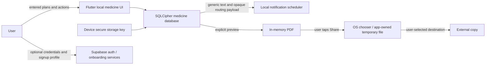

# Local release: data map and privacy/security review

Engineering assessment, 18 October 2026; **legal/clinical review is pending**. No HIPAA, GDPR, DPDP, medical-device classification or forensic-erasure certification is claimed. Product owner must assign named reviewers before release.

## Actual data flow

No medicine plan/dose/inventory upload path is implemented. Existing account onboarding is a separate network path and is **not local-only**: inspect `auth_service.dart`, `onboarding_service.dart`, schema/RLS and deployed Supabase configuration before launch. Guest onboarding bypasses it. Account credentials, profile/contact answers and optional care-circle details must be included in any published privacy notice if those legacy screens remain accessible. Sign-in does not imply medicine backup, migration, cloud deletion or active caregiver alerts.

## Data and retention

| Data | Location / purpose | Retention / deletion |
| --- | --- | --- |
| Medicine name, strength, amount/unit/form, instructions, zone, weekdays/times, date bounds, revisions | SQLCipher local database; scheduling and historical interpretation | Until individual deletion or all-local reset; Archive retains history |
| Dose occurrence snapshots and append-only Taken/Skipped/Snooze/Undo actions, UTC recording times | Same encrypted payload; correction-aware records | Individual deletion/reset removes related rows/payload entries |
| Stock baselines, consumption/reversal/refill/count ledger and thresholds | Same encrypted payload; estimates/stock audit | Individual deletion/reset; stop tracking preserves prior ledger |
| Native recovery zone/clock/boot context and low-stock episode markers | Encrypted payload; rebuild future alerts | Replaced during reconciliation; deleted with reset |
| Database key | Android secure storage / iOS device-only first-unlock keychain | Reset removes it after native and database cleanup; no key recovery |
| Active owner | Encrypted settings / secure storage fallback | Local routing; reset clears it and provider reactivates only the current local profile |
| Guest enabled, device/English/Hindi preference | SharedPreferences, no medicine content | Persists across medicine reset; app uninstall/OS behavior applies |
| Notification text, occurrence routing, timestamps | OS notification scheduler/cache | Generic visible text; obsolete alerts canceled on reconciliation/deletion/reset. Payloads are not treated as secret storage |
| PDF | Memory for preview, named temporary share file after explicit sharing | App-owned `medicine-report-*.pdf` removed on startup, individual deletion and reset. OS/recipient copies cannot be recalled; app inactivity may leave a private cache until the next cleanup |
| Diagnostics | On-demand allowlisted readiness object in Settings | Local only, no remote SDK/transmission or stored screen capture |
| Legacy account/onboarding fields and auth tokens | Supabase / secure-session client, independently of medicine data | Not removed by local medicine reset; cloud account deletion is outside epics 1–7 and must be handled before promoting account collection |

Reset has a persistent secure-storage marker. On a cleanup failure it reports failure, blocks further local mutations, and retries before opening health records. SQLite deletion/native cancellation is serialized with background reconciliation so an earlier worker is canceled and a later worker sees an empty dataset. Key/database removal does not promise forensic erasure of flash storage. Missing keys/corrupt/unsupported payloads never silently become a successful empty restore.

## SDKs, permissions and backups

- Flutter/provider/go_router are local UI/state. SQLCipher and secure storage hold health data/keys. Local notifications, timezone, WorkManager manage native alarms/recovery. PDF/printing and path_provider render and explicitly share local reports. Bundled OFL Noto Sans Devanagari avoids online font requests.
- Supabase, app_links and onboarding services are optional-account network dependencies. No advertising, analytics or remote crash SDK is added. Raw deep-link URLs and exception payloads are excluded from app debug logs; diagnostics excludes identities, medicine text, exact personal schedules, raw errors and screenshots.
- Android: notifications, exact-alarm request, boot reception, wake/work scheduling and existing Internet access for optional auth. No camera, contacts, location or health-platform permissions are needed for the local medicine scope. Inspect the merged manifest for each release.
- Android backup is disabled/excluded for health storage and keys. iOS private medicine directory is excluded from backup and key accessibility is device-only after first unlock. iOS configuration is uncompiled on this Windows host; verify backup/restore and keychain behavior on hardware before claiming support. Desktop/web fallback secure storage has a different security boundary; Android remains the launch target.

## Threat review and ownership

| Threat | Mitigation implemented / remaining | Proposed accountable role (name required) |
| --- | --- | --- |
| Lost/shared unlocked phone | Generic lock-screen text, encrypted database, OS screen-lock guidance; app is accessible on an already-unlocked device | Platform owner |
| Key loss / corrupted migration | Refuse silent key replacement or payload truncation; explicit reset only. No cloud/key restore promise | Platform owner |
| Cross-account/stale notification action | Separate owner namespace, serialized account change, authoritative occurrence revalidation; no guest auto-merge | Domain owner |
| Crash during reset / stale alarm resurrection | Durable reset marker, SQLite lock, cancellation and empty-data reconciliation; native integration regression required | Platform + QA |
| Export disclosure | Local preview, explicit chooser, health fingerprint recheck, private cache cleanup; recipients remain outside control | Experience owner |
| Malicious dependency / logs | Locked dependency versions, fixed diagnostic allowlist, redacted logging; review licenses/advisories/release binaries | Platform/security reviewer |
| Unconsented remote onboarding data | Guest path avoids it; optional legacy sign-in/signup still requires a truthful notice, deployed access review and accountable operator | Product + privacy reviewer |
| Retention / breach handling | Local delete/reset and evidence templates; assign contact, retention policy, incident owner and escalation process before launch | Product/privacy reviewer |

## India commencement review to be signed

The official [G.S.R. 843(E) commencement notification](https://www.meity.gov.in/static/uploads/2025/11/c56ceae6c383460ca69577428d36828b.pdf) dated 13 November 2025 specifies staged commencement: listed institutional provisions at Gazette publication; section 6(9) and section 27(1)(d) one year after publication; most substantive provisions listed in paragraph (c) eighteen months after publication. Do not describe the entire Act as either universally in force or universally deferred. The reviewer must calculate applicable dates from the actual publication date, confirm amendments/corrigenda and the launch date, and assess the actual processing, legal entity and market. See also the Ministry's [Rules and related notices index](https://www.meity.gov.in/documents/act-and-policies/digital-personal-data-protection-rules-2025-gDOxUjMtQWa?pageTitle=Digit).

Open decisions: scope/applicability of personal domestic local processing versus the operator's account processing; current IT/SPDI obligations; health-app/medical-software classification; data-fiduciary identity/contact; notices/consent and account deletion; cross-border Supabase hosting; rights/grievance and incident procedures. This engineering inventory is not a legal opinion. Reviewer/name/date/decision: **pending**.

## Evidence integrity

Existing MED-002 and MED-005 model fixtures and narrative reports are not independently verified study/device evidence. In particular, encryption does not establish blanket HIPAA/GDPR compliance or immunity to forensic extraction. Use actual run logs, participant notes and reviewer decisions; the scope audit supersedes unsupported completion assertions in older draft documents. Do not close issues that explicitly require teammate or physical-device review until that review occurs.
