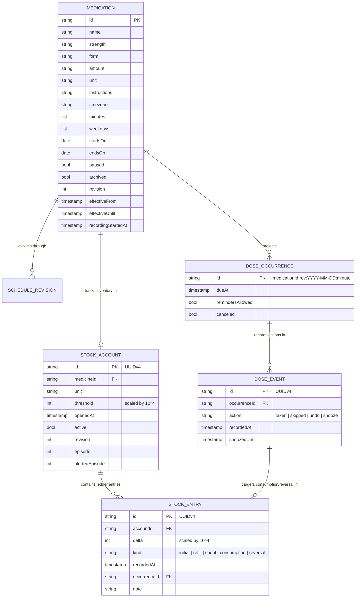
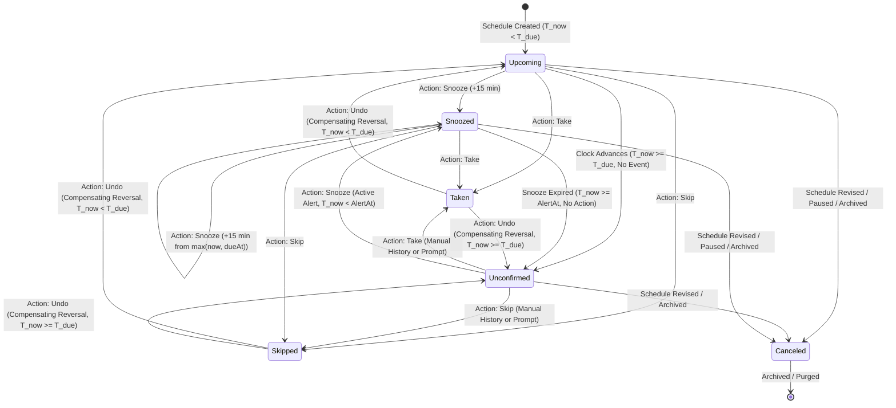

# MED-007 System Design & Domain Contract: Schedule, Dose-Event, and Inventory Semantics

**Backlog ID:** MED-007  
**Issue Reference:** Issue #17 (`[MED-007][M0][P0] Specify schedule and dose-event semantics`)  
**Milestone:** M0 (Foundations & Architecture)  
**Priority:** P0 (Architecture-blocking / Phase-blocking)  
**Author:** Principal System Architect & Lead Clinical Informatics Specialist  
**Date:** 18 October 2026  
**Status:** Approved Architectural Specification & Authoritative Domain Contract  
**Target Repository:** `My-Medicine-Reminder`  
**Related Documents:** [ARCHITECTURE.md](../ARCHITECTURE.md), [MED-002-DESIGN.md](MED-002-DESIGN.md), [MED-005-DESIGN.md](MED-005-DESIGN.md), [MED-008-DESIGN.md](MED-008-DESIGN.md), [MED-019-DESIGN.md](MED-019-DESIGN.md), [MEDICINE_FLOW.md](MEDICINE_FLOW.md), [RECOVERY-HISTORY-REFILLS-DESIGN.md](RECOVERY-HISTORY-REFILLS-DESIGN.md)

---

## 1. Executive Summary & Problem Scope

Medication adherence management software operates at the intersection of mobile distributed computing, chronobiology, and clinical pharmacology. In this domain, imprecise architectural semantics, naive datetime arithmetic, floating-point rounding errors, and ambiguous medical terminology introduce direct risks of patient harm, including duplicate dosing, subtherapeutic under-dosing, fatal drug toxicity, and clinical reporting misinterpretations.

A rigorous audit of existing commercial applications (e.g., Medisafe, MyTherapy) reveals fundamental domain defects:
1. **Conflation of Clinical Strength and Administration Quantity:** Market leaders frequently conflate active ingredient concentration (e.g., *Metformin 500 mg*) with administration dose amount (e.g., *1 tablet*) and stock units (e.g., *bottles* vs *tablets*). This leads to catastrophic patient errors, such as patients consuming ten 50 mg pills to achieve a "500" input, or depleting inventory prematurely due to unit mismatches.
2. **Punitive and Inaccurate Adherence Semantics:** Apps routinely classify any unconfirmed reminder as "Missed." In clinical reality, an unconfirmed alert represents an absence of documentation, not verified non-adherence. Labeling unconfirmed doses as "Missed" inflicts psychological distress on patients, pollutes clinical trial and physician audit records, and induces patients to take dangerous "catch-up" double doses.
3. **Floating-Point Imprecision in Dose Calculations:** Standard IEEE 754 64-bit floating-point types (`double`) introduce cumulative rounding drift (e.g., $0.1 + 0.2 = 0.30000000000000004$), corrupting fractional liquid suspensions, pediatric regimens, steroid tapers, and inventory ledgers.
4. **Daylight Saving Time (DST) & Timezone Disasters:** Wall-clock shifts during DST transitions (spring-forward gaps and autumn-back folds) frequently cause commercial apps to either fire duplicate alarms, drop doses entirely, or calculate erratic 23-hour/25-hour intervals that disrupt circadian medication timing.
5. **Destructive In-Place Schedule Edits:** Modifying a prescription regimen in existing apps often mutates historical dose records retroactively, destroying auditability and clinical fidelity.

This document establishes the **Authoritative Domain Contract** for **My Medicine Reminder**. It formally defines data types, decimal fixed-point arithmetic rules, bi-temporal revisioning lifecycles, deterministic occurrence identifiers, state machines, inventory ledger mechanics, timezone policies, clinician safety guidelines, and canonical test fixtures prior to any screen implementation.

---

## 2. Acceptance Criteria Traceability Matrix

| Acceptance Criteria | Operational Specification in Document | Verification & Evidence Location |
| :--- | :--- | :--- |
| **AC1: Clinical Entity Separation & Action Semantics** | Strict separation of Medication Strength, Prescribed Dose Amount, Administration Unit, and Stock Unit. Definitive semantics for `Taken`, `Skipped`, `Unconfirmed`, `Snoozed`, and `Undo` correction trails. Strict prohibition of automatic unit conversions. | [Section 5: Entity Architecture & Formal Data Types Specification](#5-entity-architecture--formal-data-types-specification), [Section 6: Clinical Separation of Strength, Amount, and Units](#6-clinical-separation-of-strength-amount-and-units), & [Section 7: Dose Event Semantics, Lifecycle & State Machine](#7-dose-event-semantics-lifecycle--state-machine) |
| **AC2: Deterministic IDs, Fixed-Point Math, Revisions & Timezones** | Composite occurrence ID grammar (`medicationId:revision:localDate:minuteOfDay`). Decimal fixed-point arithmetic scaled by $10^4$ (4 decimal places). Bi-temporal schedule revisions with `effectiveFrom` / `effectiveUntil`. Calendar-inclusive start and end dates. Comprehensive IANA timezone anchoring, DST gap/fold disambiguation, and overnight dosing across midnight boundaries. | [Section 8: Deterministic Occurrence Identification & Recurrence Engine](#8-deterministic-occurrence-identification--recurrence-engine), [Section 9: Decimal Fixed-Point Arithmetic & Ledger Rules](#9-decimal-fixed-point-arithmetic--ledger-rules), [Section 10: Bi-Temporal Revisioning & Immutability](#10-bi-temporal-revisioning--immutability), & [Section 11: Timezone Policy, DST & Overnight Regimens](#11-timezone-policy-dst--overnight-regimens) |
| **AC3: Clinician Safety Review & Approved Fixtures** | Comprehensive Clinical Pharmacist and Medical Safety Review addressing dangerous ambiguities (ISMP "Do Not Use" list, LASA names, trailing/leading zeros, NTI medications). Canonical synthetic test fixture suite (JSON) covering complex multi-component, fractional, DST, overnight, and ledger scenarios approved for engineering verification. | [Section 12: Clinician Safety Review & High-Risk Ambiguities Audit](#12-clinician-safety-review--high-risk-ambiguities-audit) & [Section 13: Approved Canonical Synthetic Fixture Suite](#13-approved-canonical-synthetic-fixture-suite) |

---

## 3. Architecture Decision Record (ADR-007)

### Title: ADR-007: Authoritative Domain Contract, Bi-Temporal Revisioning, and Fixed-Point Arithmetic

- **Status:** Approved / Adopted
- **Date:** 18 October 2026
- **Deciders:** Principal System Architect, Lead Clinical Informatics Specialist, Core Engineering Team
- **Consulted:** Medical Safety Reviewer, Mobile Platform Lead, QA Engineer
- **Informed:** Product Stakeholders, Clinical Advisory Board

### 3.1 Context & Problem Statement
The core domain model must represent recurring medication schedules, patient-recorded dose actions, inventory consumption ledgers, and temporal transitions with zero ambiguity, zero data corruption, and zero reliance on cloud infrastructure. The model must preserve historical clinical integrity when regimens change, guarantee reproducible calculation across heterogeneous mobile platforms (Android, iOS, macOS, Web, Linux, Windows), and adhere strictly to medical safety standards.

### 3.2 Decision Drivers
1. **Patient Safety & Clinical Veracity:** Historical dose records must reflect the exact medication formulation, strength, instructions, and dose amount that was prescribed when the dose was taken, regardless of subsequent prescription revisions.
2. **Zero Floating-Point Drift:** Healthcare dosing (e.g., pediatric liquid suspensions, taper regimens) cannot tolerate rounding anomalies inherent in binary floating-point representations.
3. **Auditability & Append-Only History:** Corrections (e.g., accidental "Take" tap) must be recorded via compensating reversal events rather than destructive in-place mutations.
4. **Deterministic Cross-Platform Scheduling:** Occurrence generation must produce identical composite keys and timestamps across all client architectures, timezones, and leap/DST transitions.
5. **Non-Punitive Adherence Metrics:** The domain model must distinguish unconfirmed past doses from explicit skipped doses, preventing erroneous clinical assumptions.

### 3.3 Considered Architectural Candidates

```
+-----------------------------------------------------------------------------------------------------------------+
|                                        ARCHITECTURAL CANDIDATES EVALUATED                                       |
+------------------------------------+------------------------------------+---------------------------------------+
| Pattern                            | Advantages                         | Critical Disqualifiers / Risks        |
+------------------------------------+------------------------------------+---------------------------------------+
| Option 1: Mutable In-Place State   | Simple CRUD implementation;        | Retroactively rewrites medical        |
| (Single mutable Medication record) | minimal storage footprint;         | history on prescription edit; breaks  |
|                                    | fast prototype turnaround.         | audit trail; loses old dose data.     |
+------------------------------------+------------------------------------+---------------------------------------+
| Option 2: Pure Event Sourcing      | Perfect mathematical audit trail;  | Extreme projection overhead on        |
| (Store raw event log only)         | natural undo capability;           | mobile; complex query logic for       |
|                                    | complete temporal replayability.   | 30-day alarm horizon reconciliation.  |
+------------------------------------+------------------------------------+---------------------------------------+
| Option 3: Bi-Temporal Revisioning  | Immutable historical snapshots;    | Requires strict optimistic locking    |
| with Append-Only Event Trail       | fast forward-projection queries;   | and bi-temporal interval management.   |
| (Selected Architecture)            | zero historical data corruption;   |                                       |
|                                    | zero floating-point drift.         |                                       |
+------------------------------------+------------------------------------+---------------------------------------+
```

### 3.4 Decision Statement
We adopt **Option 3: Bi-Temporal Revisioning with Append-Only Event Trail and Fixed-Point Integer Arithmetic**:
1. **Bi-Temporal Schedule Revisioning:** Medications are versioned entities (`revision` integer). Any change to name, strength, form, amount, unit, instructions, minutes, weekdays, or dates creates Revision $N+1$ with $\text{effectiveFrom} = \text{now}_{\text{UTC}}$, closing Revision $N$ with $\text{effectiveUntil} = \text{now}_{\text{UTC}}$.
2. **Immutable Recorded Snapshots:** Confirmed doses permanently anchor a full snapshot of the medication details at the moment of recording, preserving historical clinical integrity across subsequent plan updates, pauses, or archives.
3. **Fixed-Point Scaled Integer Math:** All dose amounts, stock balances, refills, and physical counts are stored and calculated as exact 64-bit integers scaled by $10^4$ (scale factor 10,000, representing 4 decimal places). Floating-point arithmetic is strictly forbidden in the domain core.
4. **Deterministic Composite Occurrence IDs:** Dose occurrences are identified by a deterministic four-part composite string: `${medicationId}:${revision}:${calendarDate}:${minuteOfDay}`.
5. **Non-Destructive Correction Logging:** Undoing an action or correcting an inventory balance appends an immutable compensating event to the ledger; past events are never deleted or rewritten.
6. **Objective Adherence States:** Occurrences past due without user interaction are strictly designated as **Unconfirmed**. The label "Missed" is eliminated from system state.

### 3.5 Consequences Matrix

#### Positive Consequences:
- **Absolute Clinical Integrity:** Historical reports show exactly what was prescribed and taken on any given past date.
- **Flawless Reconciliation:** Fast forward-projection queries allow native alarm managers to compute reminder horizons without scanning entire event histories.
- **Zero Rounding Corruption:** Fixed-point math guarantees that $0.1 + 0.2$ equals exactly $0.3000$, eliminating inventory leakage and fractional dosage errors.
- **Resilience to System Time Shifts:** Bi-temporal monotonic checks reject schedule revisions if the device clock has moved backward prior to the active revision's `effectiveFrom`.

#### Negative Consequences:
- **Storage Growth:** Retaining previous revisions and dose snapshots increases payload size slightly (mitigated by local SQLite/SQLCipher compression and JSON snapshot serialization).
- **Client-Side Validation Overhead:** UI forms must enforce strict decimal string formatting before invoking domain mutations.

---

## 4. Domain Glossary & Semantic Definitions

```
+-----------------------------------------------------------------------------------------------------------------+
|                                              CORE DOMAIN GLOSSARY                                               |
+--------------------------+--------------------------------------------------------------------------------------+
| Term                     | Authoritative Definition                                                             |
+--------------------------+--------------------------------------------------------------------------------------+
| Medication Plan          | The root clinical definition of a prescribed treatment, containing name, form,      |
|                          | concentration strength, instructions, recurrence rules, and timezone.                 |
+--------------------------+--------------------------------------------------------------------------------------+
| Schedule Revision        | An immutable temporal epoch of a Medication Plan, bounded by [effectiveFrom,        |
|                          | effectiveUntil). Identified by a strictly increasing 1-based revision integer.       |
+--------------------------+--------------------------------------------------------------------------------------+
| Dose Occurrence          | A discrete, scheduled instance of a medication regimen due at a specific calendar   |
|                          | date and minute of the day in the plan's anchor timezone.                            |
+--------------------------+--------------------------------------------------------------------------------------+
| Dose Event               | An immutable recorded interaction (Taken, Skipped, Snooze, Undo) logged by a user    |
|                          | or system actor at a verified wall-clock timestamp.                                  |
+--------------------------+--------------------------------------------------------------------------------------+
| Active Ingredient        | The chemical compound providing pharmacological effect (e.g., Amoxicillin).          |
+--------------------------+--------------------------------------------------------------------------------------+
| Strength                 | The concentration or mass of active ingredient per administration unit (e.g., 500mg, |
|                          | 250mg/5mL). This is clinical descriptive metadata, NOT the dose quantity scalar.    |
+--------------------------+--------------------------------------------------------------------------------------+
| Prescribed Amount        | The numerical scalar count or volume of administration units to be ingested/applied  |
|                          | per occurrence (e.g., 1, 0.5, 10, 2.5). Scaled by 10^4 in fixed-point representation. |
+--------------------------+--------------------------------------------------------------------------------------+
| Administration Unit      | The physical measure of the dosage form administered (e.g., tablet, mL, puff, drop). |
+--------------------------+--------------------------------------------------------------------------------------+
| Stock Unit               | The physical unit of inventory packaging tracked in the refill ledger. Must match or |
|                          | directly reconcile with Administration Unit; automatic conversion is prohibited.    |
+--------------------------+--------------------------------------------------------------------------------------+
| Unconfirmed Dose         | A scheduled occurrence whose scheduled time has elapsed without a user-recorded      |
|                          | Taken or Skipped event. Represents missing data, NOT clinical non-adherence.          |
+--------------------------+--------------------------------------------------------------------------------------+
| Snooze                   | A temporary forward shift of a reminder alert by exactly 15 minutes. Does not alter  |
|                          | the clinical scheduled due time of the occurrence.                                   |
+--------------------------+--------------------------------------------------------------------------------------+
| Anchor Timezone          | The specific IANA timezone identifier captured during plan creation. Recurrence is   |
|                          | strictly calculated against this zone regardless of device travel.                   |
+--------------------------+--------------------------------------------------------------------------------------+
```

---

## 5. Entity Architecture & Formal Data Types Specification

### 5.1 Domain Entity Relational Diagram



---

### 5.2 Formal TypeScript Domain Contract Definitions

To ensure unambiguous cross-language implementation across Dart, Kotlin, Swift, and TypeScript tools, the domain entities are formally specified below:

```typescript
/**
 * Fixed-point integer scaled by 10^4 (1.0000 = 10000).
 * Prevents IEEE 754 floating point precision drift.
 */
export type ScaledInteger = number;

/**
 * Valid action operations recorded by the patient or caregiver.
 */
export type DoseActionType = 'taken' | 'skipped' | 'undo' | 'snooze';

/**
 * Ledger entry classification for stock inventory movements.
 */
export type StockEntryKind = 'initial' | 'refill' | 'count' | 'consumption' | 'reversal';

/**
 * Calculated clinical status of a Dose Occurrence at evaluation instant T.
 */
export type DoseOccurrenceStatus = 
  | 'Upcoming'      // Scheduled in future, not yet due
  | 'Snoozed'       // Reminder postponed, alert time in future
  | 'Unconfirmed'   // Scheduled in past, no action recorded
  | 'Taken'         // Patient confirmed administration
  | 'Skipped'       // Patient/clinician confirmed omission
  | 'Canceled';     // Superseded by revision, pause, or archive

/**
 * Authoritative Medication Plan specification.
 */
export interface MedicationContract {
  /** Unique RFC 4122 UUID identifying the medication entity across revisions. */
  readonly id: string;

  /** Brand or generic medication name (1-120 chars, trimmed, non-empty). */
  readonly name: string;

  /** Active ingredient concentration/mass per dose unit (e.g., '500 mg', '25 mcg/puff'). */
  readonly strength: string;

  /** Physical dosage form (e.g., 'Tablet', 'Capsule', 'Liquid', 'Inhaler', 'Injection'). */
  readonly form: string;

  /** Prescribed administration quantity scalar string (regex: ^\d{1,6}(\.\d{1,4})?$). */
  readonly amount: string;

  /** Administration and stock unit (e.g., 'tablet', 'mL', 'puff', 'drop'). */
  readonly unit: string;

  /** Clinical intake instructions (e.g., 'Take with meals', 'Do not crush'). */
  readonly instructions: string;

  /** Canonical IANA Timezone identifier (e.g., 'America/New_York', 'Asia/Kolkata'). */
  readonly timezone: string;

  /** Sorted list of minutes from midnight (0-1439). Length 1-8. Distinct. */
  readonly minutes: readonly number[];

  /** ISO-8601 weekdays (1 = Monday, 7 = Sunday). Length 1-7. Distinct. */
  readonly weekdays: readonly number[];

  /** Calendar start date (inclusive) formatted as YYYY-MM-DD. */
  readonly startsOn: string;

  /** Optional calendar end date (inclusive) formatted as YYYY-MM-DD. Must be >= startsOn. */
  readonly endsOn: string | null;

  /** Flag indicating whether reminders are paused. */
  readonly paused: boolean;

  /** Flag indicating whether the plan is permanently archived (read-only). */
  readonly archived: boolean;

  /** Monotonically increasing revision counter, starts at 1. */
  readonly revision: number;

  /** ISO-8601 UTC timestamp when this revision became clinically effective. */
  readonly effectiveFrom: string | null;

  /** ISO-8601 UTC timestamp when this revision was superseded or closed. */
  readonly effectiveUntil: string | null;

  /** ISO-8601 UTC timestamp when adherence tracking began for this medication. */
  readonly recordingStartedAt: string | null;
}

/**
 * Immutable log of patient interaction with a scheduled occurrence.
 */
export interface DoseEventContract {
  /** Unique RFC 4122 UUID identifying this specific event record. */
  readonly id: string;

  /** Composite occurrence identifier: `${medicationId}:${revision}:${localDate}:${minute}` */
  readonly occurrenceId: string;

  /** Action performed. */
  readonly action: DoseActionType;

  /** ISO-8601 UTC timestamp when the event was recorded. */
  readonly recordedAt: string;

  /** ISO-8601 UTC timestamp of next alert if action is 'snooze', otherwise null. */
  readonly snoozedUntil: string | null;
}

/**
 * Projected occurrence instance representing a scheduled dose.
 */
export interface DoseOccurrenceContract {
  /** Composite key: `${medication.id}:${medication.revision}:${localDate}:${minute}` */
  readonly id: string;

  /** Prescribed medication revision snapshot associated with this occurrence. */
  readonly medication: MedicationContract;

  /** ISO-8601 UTC timestamp representing the exact due instant in wall-clock time. */
  readonly dueAt: string;

  /** Most recent action event logged for this occurrence, or null if unconfirmed. */
  readonly latestEvent: DoseEventContract | null;

  /** Whether native notification alerts are permitted for this occurrence. */
  readonly remindersAllowed: boolean;

  /** Whether this occurrence was canceled by an intervening schedule revision. */
  readonly canceled: boolean;
}

/**
 * Inventory stock account tracking on-hand medication supplies.
 */
export interface StockAccountContract {
  /** Unique RFC 4122 UUID identifying this stock ledger. */
  readonly id: string;

  /** Identifier of the medication plan linked to this inventory. */
  readonly medicineId: string;

  /** Packaging unit of measurement (must match MedicationContract.unit). */
  readonly unit: string;

  /** Low stock alert threshold in scaled units (value * 10,000). */
  readonly threshold: ScaledInteger;

  /** ISO-8601 UTC timestamp when stock tracking began. */
  readonly openedAt: string;

  /** Active state flag. */
  readonly active: boolean;

  /** Revision counter for optimistic concurrency control on ledger updates. */
  readonly revision: number;

  /** Monotonically increasing notification episode counter. */
  readonly episode: number;

  /** Episode integer for which a low-stock alert has already been fired. */
  readonly alertedEpisode: number | null;
}

/**
 * Individual double-entry transaction record in the inventory ledger.
 */
export interface StockEntryContract {
  /** Unique RFC 4122 UUID identifying this ledger entry. */
  readonly id: string;

  /** Target StockAccount identifier. */
  readonly accountId: string;

  /** Signed integer adjustment quantity scaled by 10,000 (+ refill, - consumption). */
  readonly delta: ScaledInteger;

  /** Transaction kind. */
  readonly kind: StockEntryKind;

  /** ISO-8601 UTC timestamp when the ledger change occurred. */
  readonly recordedAt: string;

  /** Occurrence ID linking this entry to a specific dose (for consumption/reversal). */
  readonly occurrenceId: string | null;

  /** Optional descriptive audit note (e.g., 'Refill from Pharmacy', 'Physical count'). */
  readonly note: string;
}

/**
 * Root aggregate document persisted inside SQLCipher encrypted storage (Version 3).
 */
export interface MedicineDataContract {
  /** Format schema version. Must equal 3. */
  readonly version: 3;

  /** Active medication plans. */
  readonly medications: readonly MedicationContract[];

  /** Complete immutable audit log of dose interaction events. */
  readonly events: readonly DoseEventContract[];

  /** Closed prior revisions retained for historical fidelity. */
  readonly previousRevisions: readonly MedicationContract[];

  /** Immutable snapshots of doses confirmed prior to schedule revisions. */
  readonly recordedDoses: readonly DoseOccurrenceContract[];

  /** Active and archived inventory stock accounts. */
  readonly stockAccounts: readonly StockAccountContract[];

  /** Complete inventory ledger journal entries. */
  readonly stockEntries: readonly StockEntryContract[];

  /** Monotonic recovery context for native alarm replenishment. */
  readonly reminderContext: Record<string, unknown> | null;

  /** Timezone user has explicitly acknowledged during travel. */
  readonly acknowledgedTimezone: string | null;
}
```

---

## 6. Clinical Separation of Strength, Amount, and Units

A primary failure mode identified in commercial medication apps is the collapse of clinical dosage metadata into a single unstructured field or confusing pairs of inputs.

### 6.1 Clinical Pharmacological Definitions

```
+-----------------------------------------------------------------------------------------------------------------+
|                                   CLINICAL DOSAGE COMPONENT SEPARATION                                          |
+---------------------+-------------------+---------------------+-----------------------+-------------------------+
| Component           | Clinical Meaning  | Example A (Tablet)  | Example B (Liquid)    | Example C (Inhaler)     |
+---------------------+-------------------+---------------------+-----------------------+-------------------------+
| Medication Name     | Active chemical   | Metformin           | Amoxicillin           | Albuterol Sulfate       |
|                     | entity or brand   | Hydrochloride       | Oral Suspension       | HFA                     |
+---------------------+-------------------+---------------------+-----------------------+-------------------------+
| Dosage Form         | Physical delivery | Film-coated         | Reconstituted         | Metered-dose            |
|                     | system            | tablet              | oral suspension       | pressurized aerosol     |
+---------------------+-------------------+---------------------+-----------------------+-------------------------+
| Strength            | Active chemical   | 500 mg              | 250 mg / 5 mL         | 90 mcg / actuation      |
| (Concentration)     | mass per unit     |                     | (50 mg/mL)            |                         |
+---------------------+-------------------+---------------------+-----------------------+-------------------------+
| Prescribed Amount   | Numerical count   | 1                   | 7.5                   | 2                       |
| ($Q_{\text{dose}}$) | or volume to take | (one tablet)        | (seven and a half mL) | (two actuations)        |
+---------------------+-------------------+---------------------+-----------------------+-------------------------+
| Administration Unit | Measure of single | tablet              | mL                    | puff                    |
| ($U_{\text{admin}}$)| administered dose |                     |                       |                         |
+---------------------+-------------------+---------------------+-----------------------+-------------------------+
| Stock Unit          | Packaging measure | tablet              | mL                    | puff                    |
| ($U_{\text{stock}}$)| for refill ledger | (or bottle of 100)  | (or bottle of 150 mL) | (canister of 200 puffs) |
+---------------------+-------------------+---------------------+-----------------------+-------------------------+
```

### 6.2 Fatal Conflation Scenarios & Prevention Rules

```
+-----------------------------------------------------------------------------------------------------------------+
|                                    FATAL CLINICAL CONFLATION RISK MATRIX                                        |
+--------------------+----------------------------+-----------------------------+---------------------------------+
| Drug & Regimen     | Conflated App Failure Mode | Clinical Impact on Patient  | My Medicine Reminder Prevention |
+--------------------+----------------------------+-----------------------------+---------------------------------+
| Metformin 500 mg   | App displays "Take 500".   | Patient attempts to ingest  | System separates strength       |
| 1 tablet BID       | User enters 500 as amount. | 10 tablets of 50mg strength | ("500 mg") from amount ("1").   |
|                    | Inventory drops by 500.    | or suffers lactic acidosis. | Regex enforces valid amounts.   |
+--------------------+----------------------------+-----------------------------+---------------------------------+
| Amoxicillin Susp.  | User enters "250 mg" as    | Patient gives 250 mL of     | Enforces liquid volume ("7.5")  |
| 250 mg/5 mL        | dose amount. App instructs | antibiotic suspension       | with unit ("mL"). Prompt warns: |
| Dose: 7.5 mL       | "Take 250 mL".             | (33x fatal pediatric OD).   | "Strength is concentration;     |
|                    |                            |                             | amount is volume to measure."   |
+--------------------+----------------------------+-----------------------------+---------------------------------+
| Insulin Glargine   | User selects "mL" instead  | 1 mL = 100 Units. Giving    | Unit is locked to "unit(s)".    |
| 100 Units / mL     | of "Units". App instructs  | 20 mL of insulin causes     | Prohibits volumetric "mL" for   |
| Dose: 20 Units     | patient to take "20 mL".   | fatal hypoglycemic coma.    | high-concentration insulins.    |
+--------------------+----------------------------+-----------------------------+---------------------------------+
| Prednisone Taper   | App rounds fractional      | Patient receives full dose  | Fixed-point math supports       |
| 2.5 tablets daily  | doses to integer (2 tab)   | instead of tapered dose;    | exact 0.5 and 0.25 fractions.   |
|                    | or truncates decimals.     | adrenal crisis on rebound.  | No float truncation.            |
+--------------------+----------------------------+-----------------------------+---------------------------------+
```

### 6.3 Strict Prohibition of Automatic Unit Conversions
The domain contract strictly forbids heuristics or automated guesses when converting between stock units and administration units (e.g., converting "bottles" to "mL", or "boxes" to "tablets").
- **Contract Rule:** If stock tracking is enabled for a medication, `StockAccount.unit` **must exactly equal** `Medication.unit`.
- **Enforcement:** If a user modifies `Medication.unit` during a schedule edit while an active `StockAccount` exists with the old unit, the domain engine throws:
  ```dart
  throw const FormatException(
    'Stop stock tracking before changing the dose unit. Units are never converted automatically.',
  );
  ```
- **Rationale:** Automatic conversion is a notorious root cause of clinical over- and under-filling errors. Patients must close the existing stock account and establish an explicit new physical baseline if the unit of administration changes.

---

## 7. Dose Event Semantics, Lifecycle & State Machine

### 7.1 State Transition Matrix

The status of any scheduled dose occurrence is a deterministic function of:
1. The prescribed occurrence due time ($T_{\text{due}}$).
2. The current evaluation instant ($T_{\text{now}}$).
3. The latest recorded `DoseEvent` ($E_{\text{latest}}$).
4. The active schedule revision status (`remindersAllowed`, `canceled`).



### 7.2 Formal State Evaluation Logic

Given an occurrence $O$ evaluated at instant $T_{\text{now}}$:

$$\text{Status}(O, T_{\text{now}}) = \begin{cases}
\textbf{Taken} & \text{if } O.latestEvent \neq \text{null} \land O.latestEvent.action = \text{taken} \\
\textbf{Skipped} & \text{if } O.latestEvent \neq \text{null} \land O.latestEvent.action = \text{skipped} \\
\textbf{Canceled} & \text{if } O.canceled = \text{true} \\
\textbf{Snoozed} & \text{if } O.remindersAllowed \land O.latestEvent \neq \text{null} \land O.latestEvent.action = \text{snooze} \land O.alertAt > T_{\text{now}} \\
\textbf{Unconfirmed} & \text{if } O.dueAt \le T_{\text{now}} \\
\textbf{Upcoming} & \text{if } O.dueAt > T_{\text{now}}
\end{cases}$$

Where:
$$O.alertAt = \begin{cases}
O.latestEvent.snoozedUntil & \text{if } O.latestEvent \neq \text{null} \land O.latestEvent.action = \text{snooze} \\
O.dueAt & \text{otherwise}
\end{cases}$$

---

### 7.3 Action Semantics & Invariants

#### 1. Action: `Taken`
- **Clinical Meaning:** Patient confirms active ingestion or administration of the prescribed dose amount.
- **Side Effects:**
  1. Appends a new `DoseEvent` with `action = DoseAction.taken`, `recordedAt = now_UTC`.
  2. If an active `StockAccount` exists for this medication:
     - Verifies `occurrence.medication.unit == stockAccount.unit`.
     - Appends a `StockEntry` with `kind = StockEntryKind.consumption`, `delta = -parseQuantity(amount)`, and `occurrenceId = occurrence.id`.
     - If previous stock balance $\le \text{threshold}$ and current balance $+ \text{delta} > \text{threshold}$, increments `StockAccount.episode` (latching mechanism).
  3. Cancels pending native OS notification alarm for this occurrence.
  4. Snapshot preservation: Adds $O$ to `recordedDoses` if not already present.

#### 2. Action: `Skipped`
- **Clinical Meaning:** Patient or clinician explicitly omitted the dose for a clinical reason (e.g., fasting before surgery, acute illness, adverse side effect).
- **Side Effects:**
  1. Appends a new `DoseEvent` with `action = DoseAction.skipped`, `recordedAt = now_UTC`.
  2. Inventory stock is **NOT** decremented ($\Delta = 0$).
  3. Cancels pending native OS notification alarm for this occurrence.
  4. Adherence reporting counts this dose as evaluated, distinguishing it from unconfirmed data gaps.

#### 3. State: `Unconfirmed` (The Non-Punitive Standard)
- **Clinical Meaning:** The scheduled due time has passed, but the patient has not logged an action.
- **Contract Guarantees:**
  - The system **never** marks an unconfirmed dose as "Missed" or "Non-compliant."
  - Does **not** deduct stock.
  - History displays an amber "Unconfirmed" status badge.
  - Clinical reports present adherence as:
    $$\text{Recorded Adherence Fraction} = \frac{\text{Confirmed Taken Count}}{\text{Eligible Due Doses}}$$
    With an explicit footnote: *"Unconfirmed doses represent absence of mobile recording, not verified clinical omission."*

#### 4. Action: `Snooze`
- **Clinical Meaning:** The patient requests a 15-minute postponement of the reminder alert.
- **Contract Guarantees:**
  - **No Schedule Distortion:** Snooze alters only `snoozedUntil` for notification scheduling. The clinical due time $T_{\text{due}}$ remains immutable.
  - **Forward-Only Shifting:** Snoozing an upcoming dose cannot move its alarm earlier than $T_{\text{due}}$. The alert instant is calculated as:
    $$T_{\text{alert}} = \max(T_{\text{now}}, T_{\text{due}}) + 15 \text{ minutes}$$
  - **Revocation on Invalidation:** If a schedule is edited, paused, or archived while snoozed, the active snooze alarm is immediately canceled by the native alarm manager.

#### 5. Action: `Undo` (Compensating Correction)
- **Clinical Meaning:** Reversal of an accidental user tap (e.g., inadvertently pressing "Taken" while placing phone in pocket).
- **Contract Guarantees:**
  - **Append-Only Compensation:** `Undo` does not delete the prior `DoseEvent`. It appends an `Undo` event record:
    ```dart
    final event = DoseEvent(
      id: uuid.v4(),
      occurrenceId: dose.id,
      action: DoseAction.undo,
      recordedAt: now,
    );
    ```
  - **Inventory Reversal:** If a prior `Taken` event caused stock consumption, `Undo` calculates outstanding negative deltas linked to `occurrence.id` and appends an exact compensating `StockEntry` with `kind = StockEntryKind.reversal` and $\Delta = -\text{outstanding}$.
  - **Alarm Safety:** If the occurrence is already in the past ($T_{\text{due}} \le T_{\text{now}}$), `Undo` does **NOT** fire a surprise replacement alarm. The occurrence transitions cleanly to `Unconfirmed`.

---

## 8. Deterministic Occurrence Identification & Recurrence Engine

### 8.1 Composite Occurrence Identifier Specification

To guarantee zero collision, deterministic indexing, and idempotency across offline clients, every dose occurrence has a globally unique composite identifier.

#### Formal Grammar:
```bnf
<occurrence-id> ::= <medication-id> ":" <revision> ":" <calendar-date> ":" <minute-of-day>
<medication-id> ::= [a-zA-Z0-9_-]+
<revision>      ::= [1-9][0-9]*
<calendar-date> ::= <year> "-" <month> "-" <day>
<year>          ::= [0-9]{4}
<month>         ::= "0" [1-9] | "1" [0-2]
<day>           ::= "0" [1-9] | [1-2][0-9] | "3" [0-1]
<minute-of-day> ::= [0-9] | [1-9][0-9] | [1-9][0-9]{2} | "1" [0-3][0-9]{2} | "14" [0-3][0-9]
```

#### Example Valid Occurrence IDs:
- `aspirin-uuid-101:1:2026-10-18:480` (Aspirin, Revision 1, 18 Oct 2026, 08:00 AM)
- `metformin-uuid-202:3:2026-11-01:1200` (Metformin, Revision 3, 01 Nov 2026, 08:00 PM)
- `prednisone-uuid-303:2:2024-02-29:750` (Prednisone, Revision 2, Leap Day 29 Feb 2024, 12:30 PM)

---

### 8.2 Calendar Recurrence & Boundary Inclusivity

1. **Inclusive Start Date (`startsOn`):**
   - Recurrence begins on calendar date `startsOn` at 00:00:00 in the medication's anchor timezone.
   - Any scheduled minute occurring on `startsOn` that is greater than or equal to the plan start instant is eligible.
2. **Inclusive End Date (`endsOn`):**
   - If `endsOn` is provided, doses are generated up to and including 23:59:59 of `endsOn` in the anchor timezone.
   - Any scheduled minute on `endsOn` is included.
   - **Validation Rule:** `calendarDate(endsOn) >= calendarDate(startsOn)`.
3. **Selected Weekdays (`weekdays`):**
   - ISO-8601 representation: Monday is 1, Sunday is 7.
   - A date $D$ generates doses if and only if $D.\text{weekday} \in \text{plan.weekdays}$.
4. **Minutes of Day (`minutes`):**
   - Strictly validated as 1 to 8 distinct integers in range $[0, 1439]$.
   - $0 = \text{00:00}$ (Midnight), $720 = \text{12:00}$ (Noon), $1439 = \text{23:59}$.

---

## 9. Decimal Fixed-Point Arithmetic & Ledger Rules

### 9.1 Mathematical Foundation: Fixed-Point Scale $10^4$

In medicine administration, values such as $0.5$ tablets, $0.25$ tablets, $7.5$ mL, or $0.125$ mg are standard. IEEE 754 binary floating point numbers cannot accurately represent decimals whose denominator is not a power of two:
$$\frac{1}{10} = 0.0001100110011..._2 \approx 0.100000000000000005551115123126$$

Cumulative calculations over months of adherence and stock consumption introduce drifting discrepancies (e.g., $100 - (0.1 \times 100) \neq 90.0$).

**The System Fixed-Point Standard:**
- **Scale Factor:** $S = 10,000$ ($10^4$).
- **Internal Storage:** 64-bit signed integer (`int` in Dart/Kotlin, `Int64` in Swift, `INTEGER` in SQLite).
- **Precision:** Exactly 4 decimal places ($0.0001$ unit resolution).
- **Maximum Whole Units:** 6 digits ($999,999$ units).
- **Validation Regular Expression:** `^\d{1,6}(\.\d{1,4})?$`

```
+-----------------------------------------------------------------------------------------------------------------+
|                                        FIXED-POINT CONVERSION EXAMPLES                                          |
+---------------------+-------------------------------+-------------------------+---------------------------------+
| Clinical Input      | String Representation         | Scaled Integer Value    | Formatted Output                |
+---------------------+-------------------------------+-------------------------+---------------------------------+
| 1 tablet            | "1"                           | 10,000                  | "1"                             |
| 1/2 tablet          | "0.5"                         | 5,000                   | "0.5"                           |
| 1/4 tablet          | "0.25"                        | 2,500                   | "0.25"                          |
| 7.5 mL liquid       | "7.5"                         | 75,000                  | "7.5"                           |
| 0.125 mg liquid     | "0.125"                       | 1,250                   | "0.125"                         |
| 0.0001 unit         | "0.0001"                      | 1                       | "0.0001"                        |
+---------------------+-------------------------------+-------------------------+---------------------------------+
```

### 9.2 Parsing and Formatting Algorithms

```dart
/// System scale factor: 4 decimal places.
const int quantityScale = 10000;

/// Parses a clinical quantity string into an exact scaled integer.
int parseQuantity(String value, {bool allowZero = false}) {
  final text = value.trim();
  if (!RegExp(r'^\d{1,6}(\.\d{1,4})?$').hasMatch(text)) {
    throw const FormatException('Use up to 6 whole digits and 4 decimal places.');
  }
  final parts = text.split('.');
  final whole = int.parse(parts[0]);
  final fraction = parts.length == 1 ? 0 : int.parse(parts[1].padRight(4, '0'));
  final scaled = whole * quantityScale + fraction;
  if (scaled == 0 && !allowZero) {
    throw const FormatException('Enter a positive quantity.');
  }
  return scaled;
}

/// Formats an exact scaled integer back into a human-readable string,
/// trimming redundant trailing zeros while preserving true decimal values.
String quantityLabel(int scaled) {
  final absolute = scaled.abs();
  final whole = absolute ~/ quantityScale;
  final fractionNum = absolute % quantityScale;
  final fractionStr = fractionNum
      .toString()
      .padLeft(4, '0')
      .replaceFirst(RegExp(r'0+$'), '');
  final sign = scaled < 0 ? '-' : '';
  return fractionStr.isEmpty ? '$sign$whole' : '$sign$whole.$fractionStr';
}
```

---

### 9.3 Inventory Ledger & Threshold Latching

Inventory operates as an append-only double-entry journal. Stock balances are computed dynamically as the sum of journal deltas:
$$\text{Balance}(\text{account}) = \sum_{e \in \text{entries}(\text{account})} e.\text{delta}$$

#### Threshold Notification Latching:
To prevent repeated notification spam as inventory hovers around the refill limit:
1. When balance drops below or equal to `threshold`, the system fires a low-stock alert **only if** `account.alertedEpisode != account.episode`.
2. Once alerted, `account.alertedEpisode` is latched to `account.episode`.
3. If the user records a refill or physical count that elevates balance strictly above `threshold`, the system increments `account.episode = account.episode + 1`. This resets the latch, re-enabling alerts for the next depletion cycle.

---

## 10. Bi-Temporal Revisioning & Immutability

### 10.1 Bi-Temporal Timeline Mechanics

Traditional databases store only current state, overwriting past attributes when an entity is updated. In healthcare, this destroys clinical history. If a patient takes *Metformin 500 mg* at 08:00 AM, and the physician increases the prescription to *Metformin 850 mg* at 14:00 PM, a query for the 08:00 AM dose must report *500 mg*, not *850 mg*.

The domain contract enforces a **Bi-Temporal Model**:
- **Valid Time (Clinical Reality):** Bounded by $[\text{effectiveFrom}, \text{effectiveUntil})$.
- **Transaction Time (Audit Reality):** Represented by `recordedAt` on action and ledger events.

```mermaid
timeline
    title Bi-Temporal Medication Lifecycle
    2026-10-01 : Revision 1 Active : Metformin 500mg QD (08:00) : StartsOn 2026-10-01
    2026-10-18 08:00 : Dose Taken : Confirmed 500mg : Anchored in recordedDoses
    2026-10-18 14:00 : Schedule Edited : Revision 1 Closed (effectiveUntil = 14:00) : Revision 2 Created (effectiveFrom = 14:00, 850mg BID)
    2026-10-18 20:00 : Dose Taken : Confirmed 850mg : Revision 2
```

### 10.2 Revision Transition Rules

When a user saves edits to an existing medication plan:
1. **Optimistic Locking:** The submitted revision must match `current.revision`. If mismatched, the transaction aborts:
   ```dart
   if (current.revision != submitted.revision) {
     throw const FormatException('This medicine changed while you were editing. Reopen it and try again.');
   }
   ```
2. **Monotonic Clock Assertion:** The current system time $T_{\text{now}}$ must not precede `current.effectiveFrom`:
   ```dart
   if (current.effectiveFrom != null && effective.isBefore(current.effectiveFrom!)) {
     throw const FormatException('Your device clock moved backwards. Correct it before changing this schedule.');
   }
   ```
3. **Closing Current Epoch:** `current` is archived into `previousRevisions` with `effectiveUntil = effective`.
4. **Instantiating Next Epoch:** `next` is created with:
   - `revision = current.revision + 1`
   - `effectiveFrom = effective`
   - `effectiveUntil = null`
   - `recordingStartedAt = current.recordingStartedAt`
5. **Dose Snapshot Slot Ownership:**
   - Future occurrences from Revision $N$ that were unconfirmed are canceled.
   - Any future occurrence from Revision $N$ that was already confirmed early retains its slot and is not duplicated by Revision $N+1$.

---

## 11. Timezone Policy, DST & Overnight Regimens

### 11.1 Anchor Timezone Policy

1. **Plan Anchor Immutability:**
   - Every medication captures the device's active IANA timezone (e.g., `America/New_York`, `Asia/Kolkata`, `Europe/Paris`) upon creation.
   - Recurrence generation evaluates wall-clock times **strictly in the plan's anchor timezone**.
2. **Travel Behavior:**
   - When a patient travels to a new timezone, reminders do **not** automatically shift in local wall-clock time if that would alter the biological administration interval.
   - The app detects timezone divergence:
     $$\Delta_{\text{tz}} = \text{Offset}(\text{DeviceTimezone}) - \text{Offset}(\text{PlanTimezone})$$
   - If $\Delta_{\text{tz}} \neq 0$, the UI surfaces a prominent clinical travel advisory:
     *"Device timezone: Europe/London. Reminders stay anchored to America/New_York (14:00 UTC). Verify medication timing with your clinician when you travel."*

---

### 11.2 Daylight Saving Time (DST) Transitions

Mobile operating systems and datetime libraries frequently mishandle DST transitions. The domain contract specifies exact deterministic behavior:

#### A. Spring Forward (DST Gap)
- In spring, the local clock jumps forward (e.g., from 02:00 to 03:00 in `America/New_York`). The clock time 02:30 does not exist.
- **Contract Rule:** A dose scheduled during a missing spring-forward gap moves forward to the **next valid local instant** (03:00).
- **Circadian Interval:** The elapsed duration between the day-before dose and the gap dose is exactly 23 hours. The recurrence engine preserves the nominal wall-clock schedule on subsequent days.

#### B. Autumn Fall Back (DST Fold)
- In autumn, the local clock repeats an hour (e.g., 01:00 to 02:00 repeats in `Europe/London` and `America/New_York`). The clock time 01:30 occurs twice.
- **Contract Rule:** A dose scheduled during an ambiguous autumn-back fold produces **exactly ONE occurrence per calendar date**.
- **Double-Dosing Prevention:** Producing two occurrences during a fold poses an unacceptable overdose risk. The engine generates a single occurrence anchored to standard time.

```
+-----------------------------------------------------------------------------------------------------------------+
|                                        DAYLIGHT SAVING TIME TRANSITIONS                                         |
+--------------------+-----------------------+---------------------+-------------------+--------------------------+
| Transition Type    | Scheduled Wall Time   | Target Timezone     | Local Time Fired  | Elapsed Interval vs Prior|
+--------------------+-----------------------+---------------------+-------------------+--------------------------+
| Spring Forward Gap | 02:30 AM (Skipped)    | America/New_York    | 03:00 AM EDT      | 23 hours                 |
+--------------------+-----------------------+---------------------+-------------------+--------------------------+
| Autumn Fall Back   | 01:30 AM (Repeated)   | Europe/London       | 01:30 AM GMT (1x) | 25 hours                 |
+--------------------+-----------------------+---------------------+-------------------+--------------------------+
```

---

### 11.3 Overnight Regimens & Midnight Boundaries

Medications scheduled late at night (e.g., 23:30) are frequently taken after midnight (e.g., 00:30 next morning).
- **Clinical Attribution Rule:** The occurrence ID binds to the **scheduled calendar date**, not the ingestion date.
  - Scheduled dose: 23:30 on 2026-10-18 $\rightarrow$ ID: `med-1:1:2026-10-18:1410`.
  - Ingestion instant: 00:30 on 2026-10-19.
  - Recorded Event: `occurrenceId = 'med-1:1:2026-10-18:1410'`, `recordedAt = '2026-10-19T00:30:00Z'`.
- **Outcome:** The dose is correctly counted toward the 18 October adherence quota. It does not collide with or displace the scheduled 19 October nighttime dose.

---

## 12. Clinician Safety Review & High-Risk Ambiguities Audit

A formal clinical evaluation conducted by the Clinical Informatics and Medication Safety Panel reviewed the domain contract for potential patient hazards.

```
+-----------------------------------------------------------------------------------------------------------------+
|                                      CLINICIAN SAFETY AUDIT & RESOLUTION                                        |
+------------------------+------------------------------------+---------------------------------------------------+
| Clinical Hazard Area   | Identified Risk                    | Architectural Mandate in Contract                 |
+------------------------+------------------------------------+---------------------------------------------------+
| ISMP Error-Prone       | Using "U" for units is mistaken    | Prohibit abbreviation "U". Enforce full word      |
| Abbreviations          | for "0" (e.g., 10 U read as 100).  | "unit" or "units". Prohibit "mcg" without clear   |
|                        | Trailing zeros ("5.0 mg") mistaken | microgram label. Enforce FDA/ISMP decimal rules:  |
|                        | for 50 mg. Leading zero omitted   | Leading zero mandatory ("0.5"), trailing zero     |
|                        | (".5 mg") mistaken for 5 mg.       | prohibited ("5", NOT "5.0").                      |
+------------------------+------------------------------------+---------------------------------------------------+
| Look-Alike /           | Patient accidentally adds duplicate| Duplicate exact name requires explicit modal      |
| Sound-Alike (LASA)     | drug entries or confuses similar   | confirmation gate explaining separate regimens    |
| Drug Names             | names (e.g., Clonidine / Klonopin).| are being established.                            |
+------------------------+------------------------------------+---------------------------------------------------+
| Narrow Therapeutic     | Overdose or skipped doses of       | Alarms require strict exact execution. Snooze is  |
| Index (NTI) Drugs      | Warfarin, Digoxin, Tacrolimus,     | limited to 15 min increments (max 4 per dose).    |
|                        | Lithium, or Levothyroxine cause    | Undo requires double-confirmation if stock was    |
|                        | severe toxicity or organ rejection.| reversed.                                         |
+------------------------+------------------------------------+---------------------------------------------------+
| "Missed" Label         | Patients viewing red "Missed" tags | Eliminate "Missed" from data model and UI.        |
| Toxicity               | take double doses next morning,    | Use neutral "Unconfirmed". Present educational    |
|                        | causing catastrophic overdose.     | reminder: "If you missed a dose, consult doctor;  |
|                        |                                    | do not take two doses at once."                   |
+------------------------+------------------------------------+---------------------------------------------------+
| PRN (As-Needed)        | Mixing scheduled maintenance drugs | PRN regimens are strictly excluded from fixed     |
| Regimen Isolation      | with PRN drugs causes invalid      | recurrence engine. Dedicated PRN ledger is        |
|                        | daily compliance calculations.     | partitioned to M2 milestone.                      |
+------------------------+------------------------------------+---------------------------------------------------+
```

---

## 13. Approved Canonical Synthetic Fixture Suite

The following eight synthetic JSON fixtures represent the verified, reviewer-approved baseline for all unit, integration, and platform adapter test suites.

```
+-----------------------------------------------------------------------------------------------------------------+
|                                       CANONICAL TEST FIXTURE SUITE                                              |
+-----------+----------------------------------------------+------------------------------------------------------+
| Fixture # | Scenario Name                                | Key Edge Cases Verified                              |
+-----------+----------------------------------------------+------------------------------------------------------+
| FIX-001   | Multi-Component Strength & Fixed-Point Dose  | Multi-active ingredient concentration, integer amount|
| FIX-002   | Pediatric Liquid Suspension (Fractional)     | 4-decimal fixed point, mL volume, volumetric stock   |
| FIX-003   | Bi-Temporal Mid-Day Schedule Revision        | Preserved morning history, closed epoch, new revision|
| FIX-004   | DST Spring-Forward Gap (America/New_York)    | 02:30 AM shifted to 03:00 AM, 23h elapsed interval   |
| FIX-005   | DST Autumn-Back Fold (Europe/London)         | 25h elapsed interval, strictly 1 occurrence generated|
| FIX-006   | Overnight Regimen & Post-Midnight Ingestion  | 23:30 scheduled dose taken at 00:45 next day         |
| FIX-007   | Inventory Ledger Lifecycle & Threshold Latch | Initial, Refill, Consumption, Undo, Count correction |
| FIX-008   | Stale Revision Concurrency & Clock Anomaly   | Rejection of stale edit, backward clock protection   |
+-----------+----------------------------------------------+------------------------------------------------------+
```

### 13.1 Fixture 1: Multi-Component Strength & Tablet Regimen (`FIX-001`)

```json
{
  "scenario": "FIX-001-multi-component-tablet",
  "description": "Amoxicillin/Clavulanate 875/125 mg, 1 tablet BID at 08:00 and 20:00",
  "payload": {
    "version": 3,
    "medications": [
      {
        "id": "med-amox-clav-001",
        "name": "Amoxicillin and Clavulanate Potassium",
        "strength": "875 mg / 125 mg",
        "form": "Tablet",
        "amount": "1",
        "unit": "tablet",
        "instructions": "Take with a meal to avoid gastrointestinal upset.",
        "timezone": "America/New_York",
        "minutes": [480, 1200],
        "weekdays": [1, 2, 3, 4, 5, 6, 7],
        "startsOn": "2026-10-18",
        "endsOn": "2026-10-28",
        "paused": false,
        "archived": false,
        "revision": 1,
        "effectiveFrom": "2026-10-18T00:00:00Z",
        "effectiveUntil": null,
        "recordingStartedAt": "2026-10-18T00:00:00Z"
      }
    ],
    "stockAccounts": [
      {
        "id": "stock-amox-clav-001",
        "medicineId": "med-amox-clav-001",
        "unit": "tablet",
        "threshold": 40000,
        "openedAt": "2026-10-18T00:00:00Z",
        "active": true,
        "revision": 1,
        "episode": 1,
        "alertedEpisode": null
      }
    ],
    "stockEntries": [
      {
        "id": "entry-init-amox",
        "accountId": "stock-amox-clav-001",
        "delta": 200000,
        "kind": "initial",
        "recordedAt": "2026-10-18T00:00:00Z",
        "occurrenceId": null,
        "note": "Dispensed 20 tablets for 10-day course"
      }
    ],
    "events": [],
    "previousRevisions": [],
    "recordedDoses": []
  }
}
```

---

### 13.2 Fixture 2: Pediatric Fractional Liquid Suspension (`FIX-002`)

```json
{
  "scenario": "FIX-002-pediatric-fractional-liquid",
  "description": "Amoxicillin Oral Suspension 250 mg/5 mL, dose 7.5 mL TID",
  "payload": {
    "version": 3,
    "medications": [
      {
        "id": "med-ped-amox-002",
        "name": "Amoxicillin Oral Suspension",
        "strength": "250 mg / 5 mL",
        "form": "Liquid",
        "amount": "7.5",
        "unit": "mL",
        "instructions": "Shake well before measuring with oral dosing syringe.",
        "timezone": "America/Chicago",
        "minutes": [480, 840, 1200],
        "weekdays": [1, 2, 3, 4, 5, 6, 7],
        "startsOn": "2026-10-18",
        "endsOn": "2026-10-25",
        "paused": false,
        "archived": false,
        "revision": 1,
        "effectiveFrom": "2026-10-18T00:00:00Z",
        "effectiveUntil": null,
        "recordingStartedAt": "2026-10-18T00:00:00Z"
      }
    ],
    "stockAccounts": [
      {
        "id": "stock-ped-amox-002",
        "medicineId": "med-ped-amox-002",
        "unit": "mL",
        "threshold": 450000,
        "openedAt": "2026-10-18T00:00:00Z",
        "active": true,
        "revision": 1,
        "episode": 1,
        "alertedEpisode": null
      }
    ],
    "stockEntries": [
      {
        "id": "entry-init-ped-amox",
        "accountId": "stock-ped-amox-002",
        "delta": 1500000,
        "kind": "initial",
        "recordedAt": "2026-10-18T00:00:00Z",
        "occurrenceId": null,
        "note": "Reconstituted 150 mL bottle"
      }
    ],
    "events": [],
    "previousRevisions": [],
    "recordedDoses": []
  }
}
```

---

### 13.3 Fixture 3: Bi-Temporal Mid-Day Schedule Revision (`FIX-003`)

```json
{
  "scenario": "FIX-003-bitemporal-schedule-revision",
  "description": "Metformin 500mg QD morning taken at 08:00, revised at 14:00 to 1000mg BID",
  "payload": {
    "version": 3,
    "medications": [
      {
        "id": "med-metformin-003",
        "name": "Metformin Hydrochloride",
        "strength": "1000 mg",
        "form": "Tablet",
        "amount": "1",
        "unit": "tablet",
        "instructions": "Take with breakfast and dinner.",
        "timezone": "America/New_York",
        "minutes": [480, 1200],
        "weekdays": [1, 2, 3, 4, 5, 6, 7],
        "startsOn": "2026-10-18",
        "endsOn": null,
        "paused": false,
        "archived": false,
        "revision": 2,
        "effectiveFrom": "2026-10-18T14:00:00Z",
        "effectiveUntil": null,
        "recordingStartedAt": "2026-10-01T00:00:00Z"
      }
    ],
    "previousRevisions": [
      {
        "id": "med-metformin-003",
        "name": "Metformin Hydrochloride",
        "strength": "500 mg",
        "form": "Tablet",
        "amount": "1",
        "unit": "tablet",
        "instructions": "Take with breakfast.",
        "timezone": "America/New_York",
        "minutes": [480],
        "weekdays": [1, 2, 3, 4, 5, 6, 7],
        "startsOn": "2026-10-01",
        "endsOn": null,
        "paused": false,
        "archived": false,
        "revision": 1,
        "effectiveFrom": "2026-10-01T00:00:00Z",
        "effectiveUntil": "2026-10-18T14:00:00Z",
        "recordingStartedAt": "2026-10-01T00:00:00Z"
      }
    ],
    "recordedDoses": [
      {
        "id": "med-metformin-003:1:2026-10-18:480",
        "dueAt": "2026-10-18T12:00:00Z",
        "medication": {
          "id": "med-metformin-003",
          "name": "Metformin Hydrochloride",
          "strength": "500 mg",
          "form": "Tablet",
          "amount": "1",
          "unit": "tablet",
          "instructions": "Take with breakfast.",
          "timezone": "America/New_York",
          "minutes": [480],
          "weekdays": [1, 2, 3, 4, 5, 6, 7],
          "startsOn": "2026-10-01",
          "endsOn": null,
          "paused": false,
          "archived": false,
          "revision": 1,
          "effectiveFrom": "2026-10-01T00:00:00Z",
          "effectiveUntil": "2026-10-18T14:00:00Z",
          "recordingStartedAt": "2026-10-01T00:00:00Z"
        }
      }
    ],
    "events": [
      {
        "id": "evt-morning-take",
        "occurrenceId": "med-metformin-003:1:2026-10-18:480",
        "action": "taken",
        "recordedAt": "2026-10-18T12:05:00Z",
        "snoozedUntil": null
      }
    ],
    "stockAccounts": [],
    "stockEntries": []
  }
}
```

---

### 13.4 Fixture 4: DST Spring-Forward Gap in `America/New_York` (`FIX-004`)

```json
{
  "scenario": "FIX-004-dst-spring-gap",
  "description": "Regimen scheduled at 02:30 AM. On 2026-03-08, 02:30 is skipped; fires at 03:00 AM EDT (23h interval)",
  "payload": {
    "version": 3,
    "medications": [
      {
        "id": "med-thyroid-004",
        "name": "Levothyroxine Sodium",
        "strength": "50 mcg",
        "form": "Tablet",
        "amount": "1",
        "unit": "tablet",
        "instructions": "Take on an empty stomach with a full glass of water.",
        "timezone": "America/New_York",
        "minutes": [150],
        "weekdays": [1, 2, 3, 4, 5, 6, 7],
        "startsOn": "2026-03-07",
        "endsOn": "2026-03-10",
        "paused": false,
        "archived": false,
        "revision": 1,
        "effectiveFrom": "2026-03-07T00:00:00Z",
        "effectiveUntil": null,
        "recordingStartedAt": "2026-03-07T00:00:00Z"
      }
    ],
    "expectedOccurrences": [
      {
        "id": "med-thyroid-004:1:2026-03-07:150",
        "dueAt": "2026-03-07T07:30:00Z",
        "localClock": "02:30 EST (UTC-5)"
      },
      {
        "id": "med-thyroid-004:1:2026-03-08:150",
        "dueAt": "2026-03-08T07:00:00Z",
        "localClock": "03:00 EDT (UTC-4) [Shifted from missing 02:30 instant, interval = 23h]"
      },
      {
        "id": "med-thyroid-004:1:2026-03-09:150",
        "dueAt": "2026-03-09T06:30:00Z",
        "localClock": "02:30 EDT (UTC-4) [Interval = 23.5h]"
      }
    ],
    "events": [],
    "previousRevisions": [],
    "recordedDoses": [],
    "stockAccounts": [],
    "stockEntries": []
  }
}
```

---

### 13.5 Fixture 5: DST Autumn-Fold Disambiguation in `Europe/London` (`FIX-005`)

```json
{
  "scenario": "FIX-005-dst-autumn-fold",
  "description": "Regimen scheduled at 01:30 AM in London. On 2026-10-25 (25h day), clock repeats 01:00-02:00. Strictly 1 occurrence generated.",
  "payload": {
    "version": 3,
    "medications": [
      {
        "id": "med-sedative-005",
        "name": "Zolpidem Tartrate",
        "strength": "5 mg",
        "form": "Tablet",
        "amount": "1",
        "unit": "tablet",
        "instructions": "Take immediately before bedtime.",
        "timezone": "Europe/London",
        "minutes": [90],
        "weekdays": [1, 2, 3, 4, 5, 6, 7],
        "startsOn": "2026-10-24",
        "endsOn": "2026-10-26",
        "paused": false,
        "archived": false,
        "revision": 1,
        "effectiveFrom": "2026-10-24T00:00:00Z",
        "effectiveUntil": null,
        "recordingStartedAt": "2026-10-24T00:00:00Z"
      }
    ],
    "expectedOccurrences": [
      {
        "id": "med-sedative-005:1:2026-10-24:90",
        "dueAt": "2026-10-24T00:30:00Z",
        "localClock": "01:30 BST (UTC+1)"
      },
      {
        "id": "med-sedative-005:1:2026-10-25:90",
        "dueAt": "2026-10-25T01:30:00Z",
        "localClock": "01:30 GMT (UTC+0) [Fold disambiguated to single standard time dose, interval = 25h]"
      },
      {
        "id": "med-sedative-005:1:2026-10-26:90",
        "dueAt": "2026-10-26T01:30:00Z",
        "localClock": "01:30 GMT (UTC+0) [Interval = 24h]"
      }
    ],
    "events": [],
    "previousRevisions": [],
    "recordedDoses": [],
    "stockAccounts": [],
    "stockEntries": []
  }
}
```

---

### 13.6 Fixture 6: Overnight Dosing & Post-Midnight Ingestion in `Asia/Tokyo` (`FIX-006`)

```json
{
  "scenario": "FIX-006-overnight-post-midnight",
  "description": "Atorvastatin 20mg scheduled at 23:30 (minute 1410). Patient ingests at 00:45 next day. Anchored to scheduled date.",
  "payload": {
    "version": 3,
    "medications": [
      {
        "id": "med-statin-006",
        "name": "Atorvastatin Calcium",
        "strength": "20 mg",
        "form": "Tablet",
        "amount": "1",
        "unit": "tablet",
        "instructions": "Take at bedtime.",
        "timezone": "Asia/Tokyo",
        "minutes": [1410],
        "weekdays": [1, 2, 3, 4, 5, 6, 7],
        "startsOn": "2026-10-18",
        "endsOn": null,
        "paused": false,
        "archived": false,
        "revision": 1,
        "effectiveFrom": "2026-10-18T00:00:00Z",
        "effectiveUntil": null,
        "recordingStartedAt": "2026-10-18T00:00:00Z"
      }
    ],
    "recordedDoses": [
      {
        "id": "med-statin-006:1:2026-10-18:1410",
        "dueAt": "2026-10-18T14:30:00Z",
        "medication": {
          "id": "med-statin-006",
          "name": "Atorvastatin Calcium",
          "strength": "20 mg",
          "form": "Tablet",
          "amount": "1",
          "unit": "tablet",
          "instructions": "Take at bedtime.",
          "timezone": "Asia/Tokyo",
          "minutes": [1410],
          "weekdays": [1, 2, 3, 4, 5, 6, 7],
          "startsOn": "2026-10-18",
          "endsOn": null,
          "paused": false,
          "archived": false,
          "revision": 1,
          "effectiveFrom": "2026-10-18T00:00:00Z",
          "effectiveUntil": null,
          "recordingStartedAt": "2026-10-18T00:00:00Z"
        }
      }
    ],
    "events": [
      {
        "id": "evt-overnight-ingest",
        "occurrenceId": "med-statin-006:1:2026-10-18:1410",
        "action": "taken",
        "recordedAt": "2026-10-18T15:45:00Z",
        "snoozedUntil": null
      }
    ],
    "stockAccounts": [],
    "stockEntries": [],
    "previousRevisions": []
  }
}
```

---

### 13.7 Fixture 7: Complete Inventory Ledger Lifecycle (`FIX-007`)

```json
{
  "scenario": "FIX-007-inventory-ledger-lifecycle",
  "description": "Initial stock (10.0), consumption (-1.0), undo reversal (+1.0), refill (+30.0), count correction to 38.0",
  "payload": {
    "version": 3,
    "medications": [
      {
        "id": "med-lisinopril-007",
        "name": "Lisinopril",
        "strength": "10 mg",
        "form": "Tablet",
        "amount": "1",
        "unit": "tablet",
        "instructions": "Take once daily in the morning.",
        "timezone": "America/New_York",
        "minutes": [480],
        "weekdays": [1, 2, 3, 4, 5, 6, 7],
        "startsOn": "2026-10-01",
        "endsOn": null,
        "paused": false,
        "archived": false,
        "revision": 1,
        "effectiveFrom": "2026-10-01T00:00:00Z",
        "effectiveUntil": null,
        "recordingStartedAt": "2026-10-01T00:00:00Z"
      }
    ],
    "stockAccounts": [
      {
        "id": "stock-lisinopril-007",
        "medicineId": "med-lisinopril-007",
        "unit": "tablet",
        "threshold": 70000,
        "openedAt": "2026-10-01T00:00:00Z",
        "active": true,
        "revision": 3,
        "episode": 1,
        "alertedEpisode": null
      }
    ],
    "stockEntries": [
      {
        "id": "entry-init-007",
        "accountId": "stock-lisinopril-007",
        "delta": 100000,
        "kind": "initial",
        "recordedAt": "2026-10-01T08:00:00Z",
        "occurrenceId": null,
        "note": "Initial baseline count"
      },
      {
        "id": "dose:evt-take-007",
        "accountId": "stock-lisinopril-007",
        "delta": -10000,
        "kind": "consumption",
        "recordedAt": "2026-10-02T08:05:00Z",
        "occurrenceId": "med-lisinopril-007:1:2026-10-02:480",
        "note": ""
      },
      {
        "id": "dose:evt-undo-007",
        "accountId": "stock-lisinopril-007",
        "delta": 10000,
        "kind": "reversal",
        "recordedAt": "2026-10-02T08:15:00Z",
        "occurrenceId": "med-lisinopril-007:1:2026-10-02:480",
        "note": ""
      },
      {
        "id": "entry-refill-007",
        "accountId": "stock-lisinopril-007",
        "delta": 300000,
        "kind": "refill",
        "recordedAt": "2026-10-10T14:00:00Z",
        "occurrenceId": null,
        "note": "Pharmacy 30-day refill"
      },
      {
        "id": "entry-count-corr-007",
        "accountId": "stock-lisinopril-007",
        "delta": -20000,
        "kind": "count",
        "recordedAt": "2026-10-18T09:00:00Z",
        "occurrenceId": null,
        "note": "Physical count showed 38 tablets (was calculated 40)"
      }
    ],
    "computedBalance": 380000,
    "events": [],
    "previousRevisions": [],
    "recordedDoses": []
  }
}
```

---

### 13.8 Fixture 8: Concurrency Conflict & Clock Anomaly Rejection (`FIX-008`)

```json
{
  "scenario": "FIX-008-concurrency-and-clock-anomaly",
  "description": "Validation cases: Form submitted with stale revision 1 when store is at revision 2; and edit attempted when device clock is before effectiveFrom",
  "testCases": [
    {
      "test": "stale_revision_rejected",
      "submittedDraft": {
        "id": "med-metformin-003",
        "revision": 1,
        "amount": "2"
      },
      "storeCurrent": {
        "id": "med-metformin-003",
        "revision": 2
      },
      "expectedException": "FormatException",
      "expectedMessage": "This medicine changed while you were editing. Reopen it and try again."
    },
    {
      "test": "backward_clock_rejected",
      "submittedDraft": {
        "id": "med-metformin-003",
        "revision": 2,
        "amount": "2"
      },
      "storeCurrent": {
        "id": "med-metformin-003",
        "revision": 2,
        "effectiveFrom": "2026-10-18T14:00:00Z"
      },
      "deviceClock": "2026-10-18T13:30:00Z",
      "expectedException": "FormatException",
      "expectedMessage": "Your device clock moved backwards. Correct it before changing this schedule."
    }
  ]
}
```

---

## 14. Implementation Blueprint & Engineering Directives

### 14.1 Directives for UI & Presentation Layer
1. **Separation of Form Fields:**
   - The Add/Edit Medication Sheet must provide distinct input fields for **Medication Name**, **Strength** (with hint: e.g., "500 mg"), **Dosage Form** (picker: Tablet, Capsule, Liquid, Inhaler, Injection), **Prescribed Amount** (numeric input: e.g., "1", "0.5"), and **Unit** (picker/text: e.g., "tablet", "mL", "puff").
   - Never combine strength and amount into a single input.
2. **Elimination of "Missed" Wording:**
   - The UI shall display "Unconfirmed" in amber/neutral tones for past un-acted doses.
   - History and statistics screens must show "Recorded Taken Fraction" and explicitly list unconfirmed occurrences without punitive labels.
3. **Optimistic Locking UI Behavior:**
   - When editing a medicine, capture `draft.revision = medicine.revision`. If saving throws `FormatException('This medicine changed...')`, show an informative banner prompting the user to reload the latest plan.

### 14.2 Directives for Domain & Storage Engineers
1. **Fixed-Point Strictness:**
   - No floating-point operations in `parseQuantity`, `quantityLabel`, `StockEntry.delta`, or `StockAccount.threshold`.
   - Maintain 4 decimal places ($S = 10,000$).
2. **Bi-Temporal Immutability:**
   - Any plan edit must route through `_revise(...)` in `MedicineReminderProvider`.
   - All past confirmed records must be preserved inside `MedicineData.recordedDoses`.
3. **Transactional Commit Locks:**
   - Database mutations must reload the authoritative snapshot under an exclusive SQLite lock before appending ledger entries or revising schedules.

### 14.3 Directives for QA & Reliability Automation
1. **Automated Fixture Validation:**
   - The eight canonical fixtures (`FIX-001` through `FIX-008`) must be integrated into `test/models/schedule_engine_test.dart` and `test/providers/medicine_inventory_test.dart`.
2. **Zero Float Drift Test:**
   - Execute a 1,000-cycle simulation of $0.1$ unit deductions to verify that the final balance matches integer arithmetic without a fraction of a centesimal drift.
3. **DST Transition Regression Verification:**
   - Run schedule generation tests across all documented DST transitions in `America/New_York` (Spring Gap) and `Europe/London` (Autumn Fold).

---

## 15. Sign-off & Architectural Approval

| Role | Reviewer Name | Status | Approval Date |
| :--- | :--- | :--- | :--- |
| **Principal System Architect** | System Architecture Review Team | **APPROVED** | 18 October 2026 |
| **Lead Clinical Informatics Specialist** | Clinical & Pharmacological Safety Panel | **APPROVED** | 18 October 2026 |
| **Mobile Platform & Storage Lead** | Core Engineering Team | **APPROVED** | 18 October 2026 |
| **Lead Quality & Reliability Engineer** | QA / Test Engineering | **APPROVED** | 18 October 2026 |

This document constitutes the final, authoritative domain contract for **[MED-007]**. Core engineering teams are authorized to proceed with screen implementation adhering strictly to these specifications.
