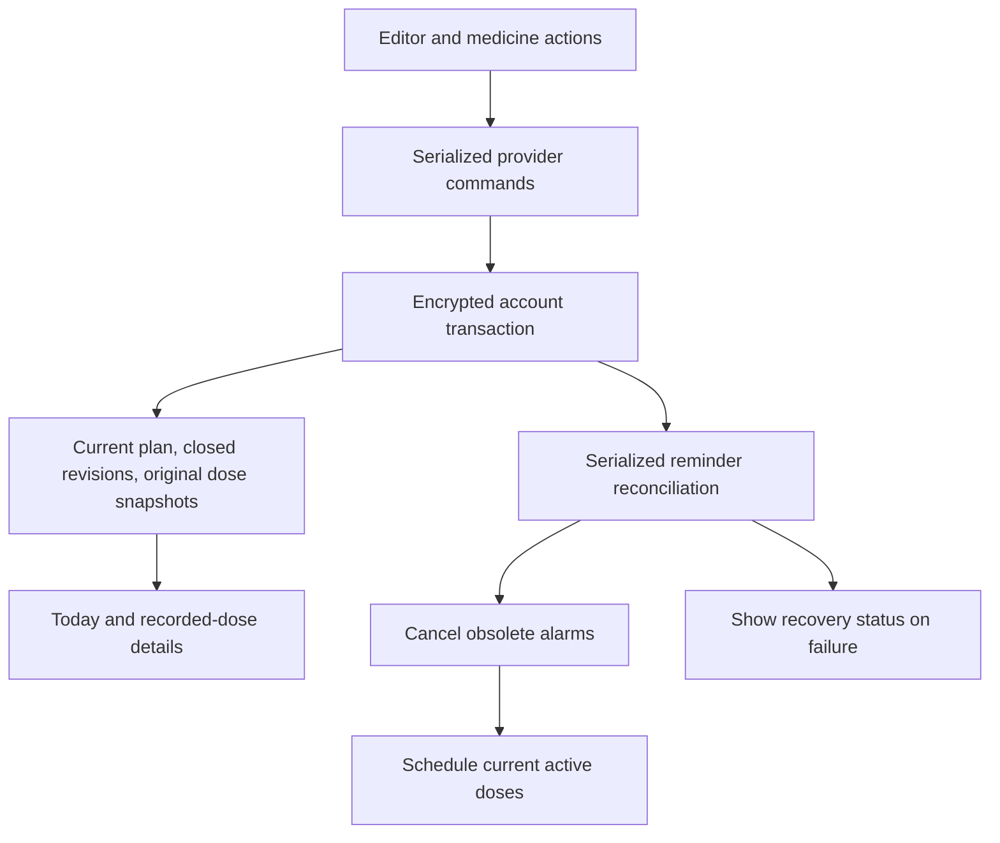

# MED-019: edit, pause, resume, and archive

## Behavior and boundaries

Edits take effect at the successful save time, shown in the editor before saving
and on the saved plan afterwards. A new revision owns occurrences at or after
that instant; the previous revision owns earlier occurrences. Dates remain
inclusive in the plan's existing named timezone. No timezone change is inferred
from travel. Archived plans are read-only and never schedule reminders.

Pause only pauses app reminders. Resume starts a new active revision at the
resume instant and does not replay missed or snoozed alerts. Archive closes the
current revision and preserves plan versions, recorded doses, and action trails.
Permanent deletion remains a separate explicit destructive operation.

## Data and recurrence

- `Medication`: immutable versioned plan with optional UTC effective bounds.
- `MedicineData.medications`: latest version for each medicine identity.
- `MedicineData.previousRevisions`: closed immutable plan versions.
- `MedicineData.recordedDoses`: original occurrence snapshots captured on the
  first action; later actions append to the existing event trail.
- Payload version 2 reads version 1 and reconstructs snapshots for existing
  action trails before future writes. The encrypted database schema/key stays
  unchanged; account isolation and background-worker transactions still apply.

One `MedicineData.doses` projection combines bounded plan versions and recorded
snapshots for Today and dose details. Original confirmed doses survive even when
recorded early for a future occurrence. A recorded occurrence claims the same
medicine/time slot across revisions, preventing a second dose at that instant.
Superseded snoozes do not survive as alerts. Retired future confirmations can be
undone, but cannot be re-snoozed or treated as a new scheduled dose. Prior due
doses can still be recorded or corrected without restoring alerts.

Notifications use only the current active revision, with completed recorded
slots excluded. The same projection drives foreground and background scheduling.

## Commands and consistency

The provider serializes commands. Each mutation reloads authoritative encrypted
data, checks the submitted revision, validates the draft, and atomically commits
the closed previous version and new current version. Stale editor submissions
are rejected with a reopen message. Repeated pause/archive commands are
idempotent. Notification actions are validated again against current state.

The database and OS alarm APIs cannot participate in a shared atomic transaction.
After committing the plan, reconciliation runs under the existing store lock:
cancel obsolete pending/visible alarms first, then install replacements. A
failure keeps the committed plan and exposes reminder recovery. Startup, resume,
manual retry, and the Android worker reconcile from durable state. A tiny
commit-to-cancel/crash window remains; stale notification actions are rejected.

## UI

Visual thesis: preserve the calm teal app, readable rows, and existing sheet.
Content plan: medicine options open a prefilled editor; explain effective time,
preview future doses, then save. Active/Archived filtering keeps old plans
discoverable; recorded-dose details retain the original medicine description.
Interaction thesis: reuse the sheet transition, menu disclosure, and existing
list switch animation; show busy/error state during mutations.

The editor preserves the plan timezone and paused state. Archive and pause use
clear confirmation text; archive explains retained records. No new navigation
framework, cloud sync, inventory, or general history dashboard is introduced.

## Review and validation plan

Review all data transforms for retained versions/snapshots, effective-boundary
ownership, stale writes, account changes, and stale notification intents.
Regression tests cover edit during snooze, early confirmation, same-slot edits,
end-date removal/shortening, weekday changes, pause/resume gaps, archive/restart,
rapid repeated edits, failed writes/scheduling, and version-1 migration. Widget
tests exercise prefilled editing, save/retry, archive visibility/records, and
small-screen enlarged text. Native Android integration checks real pending alarm
replacement and archive cancellation. Run formatting, analysis, and full tests.
