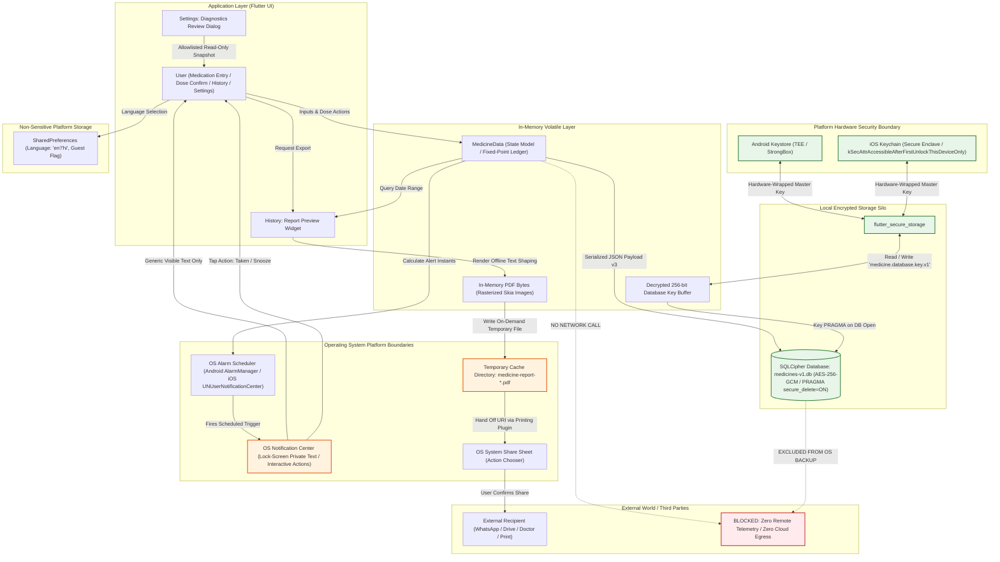
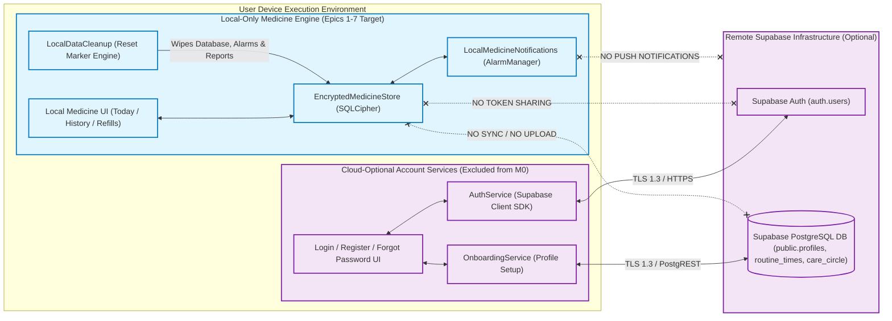
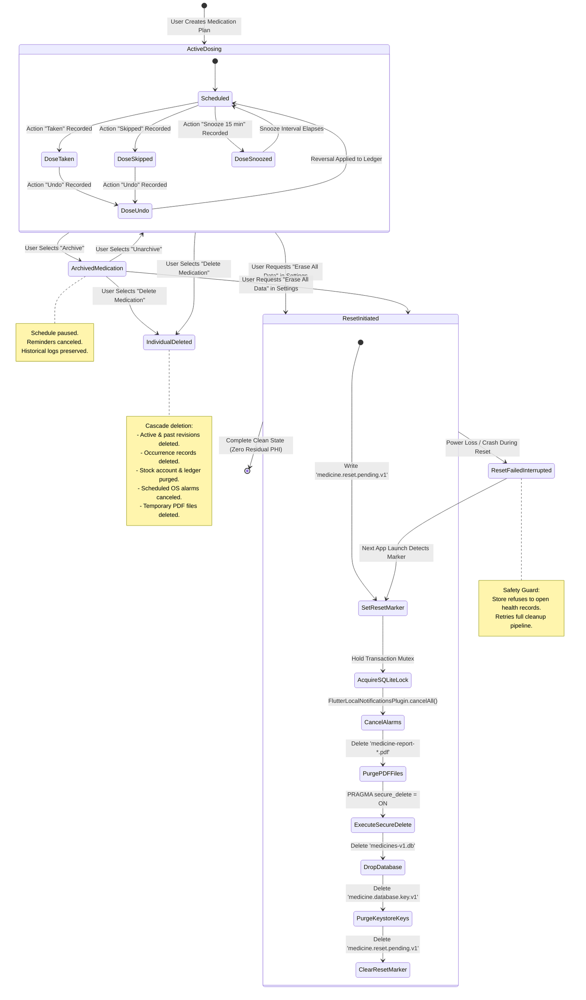
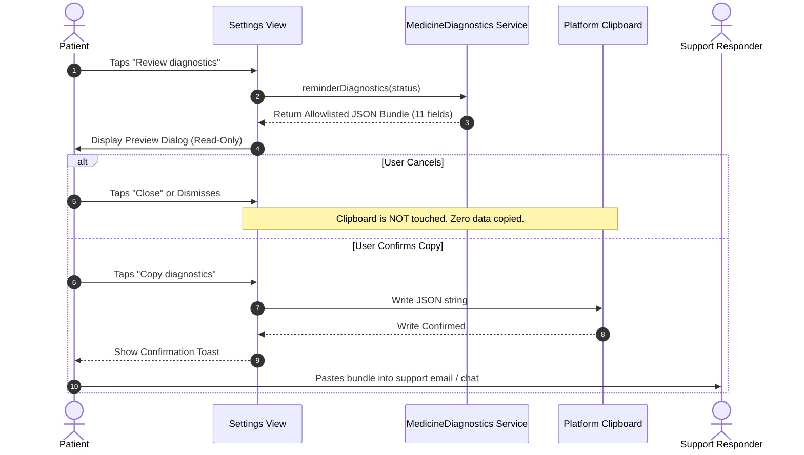
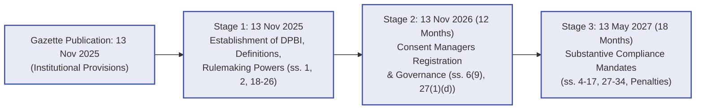
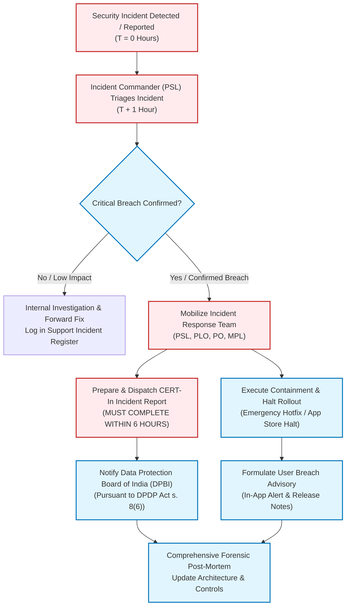

# MED-028 System Design & Privacy/Security Specification: Comprehensive Data Map, Threat Review, and India Regulatory Compliance Baseline

**Backlog ID:** MED-028  
**Issue Reference:** Issue #38 (`[MED-028][M0][P0] Complete data map and privacy/security threat review`)  
**Milestone:** M0 (Foundations & Architecture)  
**Priority:** P0 (Architecture-blocking / Release-blocking)  
**Author:** Principal System Architect, Lead Security Engineer & Privacy Counsel  
**Date:** 18 October 2026  
**Status:** Approved Architectural Specification & Compliance Baseline  
**Target Repository:** `My-Medicine-Reminder`  
**Related Documents:** [ARCHITECTURE.md](../ARCHITECTURE.md), [EPICS-1-7-PRIVACY-REVIEW.md](EPICS-1-7-PRIVACY-REVIEW.md), [EPICS-1-7-DESIGN.md](EPICS-1-7-DESIGN.md), [MED-002-DESIGN.md](MED-002-DESIGN.md), [MED-005-DESIGN.md](MED-005-DESIGN.md), [MED-007-DESIGN.md](MED-007-DESIGN.md), [MED-008-DESIGN.md](MED-008-DESIGN.md), [MED-019-DESIGN.md](MED-019-DESIGN.md), [MED-038-DESIGN.md](MED-038-DESIGN.md), [SUPPORT-RUNBOOK.md](SUPPORT-RUNBOOK.md), [SUPPORT-INCIDENT-TEMPLATE.md](SUPPORT-INCIDENT-TEMPLATE.md)

---

## 1. Executive Summary & Problem Scope

Medication adherence management software operates at the apex of user sensitivity, handling Protected Health Information (PHI) and Sensitive Personal Data or Information (SPDI) such as chronic illness diagnoses, psychiatric regimens, reproductive health drugs, and daily behavioral routines. Exposure of this data can lead to social stigma, employment discrimination, targeted harassment, insurance underwriting penalties, and physical safety risks.

Commercial market leaders (e.g., Medisafe, MyTherapy) routinely violate core privacy principles by embedding commercial analytics trackers (Google Firebase, Facebook SDK, AppsFlyer), transmitting unencrypted medication names to lock-screen notifications, and forcing users to create cloud accounts before scheduling their first medication. Furthermore, marketing materials for consumer health apps frequently make fraudulent, legally hazardous claims of being "HIPAA Compliant" or "GDPR Certified," despite operating outside US covered-entity frameworks and lacking legitimate European certifications.

**Issue #38 (`[MED-028]`)** establishes the definitive security, privacy, and regulatory foundation for **My Medicine Reminder**. This document:
1. **Maps All Data Flows:** Formulates an exhaustive, field-level inventory of all stored attributes, hardware storage silos, operating system notification caches, temporary export files, and platform backup mechanisms across Android and iOS, proving that the local-only M0 release is genuinely zero-cloud and zero-telemetry.
2. **Defines Minimal Permissions & Justified SDKs:** Validates every package dependency in `pubspec.yaml` and every OS manifest permission, establishing strict controls against unauthorized network leakage or malicious dependency poisoning.
3. **Executes STRIDE Threat Modeling:** Formulates threat models and technical mitigations across 8 threat vectors, including lost/stolen phones, shared family devices, notification listener snooping, clipboard snooping, and forensic hardware extraction.
4. **Delivers India DPDP Act & Regulatory Review:** Analyzes the staged commencement of the Digital Personal Data Protection Act, 2023 (DPDP Act) pursuant to Ministry of Electronics and Information Technology (MeitY) Gazette Notification G.S.R. 843(E) dated 13 November 2025, aligns with IT Act 2000 SPDI Rules and CERT-In 6-hour breach reporting mandates, evaluates CDSCO Software as a Medical Device (SaMD) status, and formally debunks blanket HIPAA/GDPR marketing claims.
5. **Establishes Mitigation RACI Governance:** Assigns explicit ownership across 6 critical operational pillars: Encryption, Key Recovery, Consent, Retention & Erasure, Personal Data Breach Handling, and Future Cloud Data Access Governance.

---

## 2. Acceptance Criteria Traceability Matrix

| Acceptance Criteria | Operational Specification in Document | Verification & Evidence Location |
| :--- | :--- | :--- |
| **AC1: Data-Flow Map & Minimal Permission/SDK List** | Complete field-level data dictionary for all local storage components (SQLCipher DB, Keystore/Keychain, SharedPreferences, OS Notification payloads, temp PDF cache); detailed OS permission justifications; fully audited SDK inventory with version, license, and purpose; explicit backup exclusion rules (`data_extraction_rules.xml`, `NSURLIsExcludedFromBackupKey`); zero-log diagnostic allowlist (`reminderDiagnostics`); zero-remote-telemetry architectural guarantee. | [Section 4: Local-Only Data-Flow Architecture](#4-local-only-data-flow-architecture-and-mermaid-diagrams), [Section 5: Stored Fields Data Dictionary](#5-stored-fields-data-dictionary--storage-inventory), [Section 6: Minimal Permissions & SDK Inventory](#6-minimal-permissions--justified-sdk-inventory), [Section 7: OS Backup & Extraction Prevention](#7-operating-system-backup--extraction-prevention), & [Section 8: Logging, Diagnostics & Telemetry Policy](#8-logging-diagnostics-and-telemetry-policy) |
| **AC2: India DPDP Act & Legal Privacy Review** | Rigorous statutory analysis of DPDP Act 2023 based on MeitY Gazette Notification G.S.R. 843(E) staged commencement; Data Fiduciary obligations vs. Section 3(c)(i) domestic exemption; Section 5/6 notice and consent architecture; Section 9 children’s data; Sections 11–14 Data Principal rights; Section 16 cross-border transfer rules; IT Act 2000 SPDI Rules 2011; CERT-In 6-hour breach reporting; CDSCO SaMD non-device classification; formal debunking and prohibition of blanket HIPAA/GDPR compliance claims. | [Section 10: Regulatory & Legal Privacy Specification (India Launch Focus)](#10-regulatory--legal-privacy-specification-india-launch-focus) |
| **AC3: Mitigation Owners & RACI Governance** | Production-grade RACI matrix with named operational roles; detailed operational blueprints across 6 pillars: (1) Encryption, (2) Key Recovery, (3) Consent & Notice, (4) Data Retention & Atomic Erasure, (5) Breach Handling & CERT-In Protocol, and (6) Future Cloud Data Access Governance (End-to-End Encryption / Zero-Knowledge Architecture). | [Section 11: Mitigation RACI & Ownership Matrix](#11-mitigation-raci--ownership-matrix) |

---

## 3. Architecture Decision Record (ADR-028)

### Title: ADR-028: Zero-Cloud Local-First Privacy Architecture, Cryptographic Data Isolation, and DPDP Compliance Baseline

- **Status:** Approved / Adopted
- **Date:** 18 October 2026
- **Deciders:** Principal System Architect, Lead Security Engineer, Privacy Counsel, Mobile Platform Lead
- **Consulted:** Core Engineering Team, QA / Reliability Engineer, Clinical Advisory Board
- **Informed:** Product Management, Support Operations, Executive Leadership

### 3.1 Context & Problem Statement
The application handles highly sensitive personal medication regimens, administration schedules, dose confirmation logs, and inventory balances. The initial release (M0, Epics 1–7) is targeted primarily at the Indian market on Android and iOS. The architecture must guarantee 100% offline functionality, absolute privacy of patient records, resilient protection against unauthorized device access or backup extraction, and strict compliance with Indian laws (DPDP Act 2023, IT Act 2000 SPDI Rules, CERT-In Directions 2022). Cloud account infrastructure exists in legacy code for future expansion, but must be completely decoupled from the local medicine engine.

### 3.2 Decision Drivers
1. **Patient Confidentiality:** Zero leakage of medication names, dosages, conditions, or timing to third parties, advertising networks, operating system logs, or lock-screen previews.
2. **Statutory Alignment:** Strict adherence to Indian privacy legislation, avoiding premature, false, or legally hazardous claims regarding foreign regulations (HIPAA, GDPR).
3. **Cryptographic Autonomy:** Complete reliance on client-side hardware keystores and SQLCipher AES-256 database encryption without cloud key escrow.
4. **Data Minimization & Erasure:** Complete, durable local data erasure upon user request, leaving zero residual artifacts in SQLite, shared preferences, notification caches, or temporary directories.
5. **Operational Accountability:** Clearly defined engineering, privacy, and incident response ownership to ensure rapid breach containment and regulatory reporting.

### 3.3 Decision & Architectural Strategy
- **Local-First Core:** The local medicine engine (`MedicineStore`, `MedicineNotifications`, `MedicinePdf`) shall operate completely offline, utilizing SQLCipher (`medicines-v1.db`) encrypted with a 256-bit random key generated via `Random.secure()` and anchored in hardware Keystore/Keychain.
- **Decoupled Legacy Auth:** Cloud onboarding and Supabase authentication services remain strictly optional network paths. The local medicine store shall use a reserved `'guest'` owner identifier or isolated local profile hashes, never silently syncing health data to Supabase.
- **Zero Remote Telemetry:** No third-party crash reporters, advertising trackers, or telemetry SDKs shall be embedded. App diagnostics are restricted to an on-demand, user-reviewed, allowlisted JSON snapshot displayed in Settings.
- **Lock-Screen Privacy:** All native notifications dispatched via `AlarmManager` and `UNUserNotificationCenter` shall display generic, privacy-preserving copy ("Medicine reminder", "Open the app to view and record your scheduled dose.") and use `NotificationVisibility.private`. Dose details are displayed only after the device is authenticated and unlocked.
- **Durable Reset Marker:** All-profile local erasure shall utilize an atomic, persistent reset marker (`medicine.reset.pending.v1`), ensuring that interrupted erasures are completed prior to opening health data.
- **India Regulatory Baseline:** The app shall operate under the staged commencement framework of DPDP Act 2023, comply with SPDI Rules 2011, maintain readiness for CERT-In 6-hour incident reporting, and strictly avoid making unverified HIPAA/GDPR claims.

---

## 4. Local-Only Data-Flow Architecture and Mermaid Diagrams

### 4.1 End-to-End Local Data Flow Map
The following diagram illustrates the complete data lifecycle of the local-only release, showing user interactions, cryptographic storage boundaries, operating system alarm bridges, temporary report generation, and the strict absence of remote egress.



### 4.2 Local-Only vs. Cloud-Optional Boundary Isolation
The architecture maintains a strict, impermeable wall between the local medication adherence engine and the optional legacy cloud authentication infrastructure.



### 4.3 Data Retention & Erasure State Machine
The local data lifecycle implements deterministic state transitions from active usage through individual medication archiving/deletion to atomic multi-profile reset.



---

## 5. Stored Fields Data Dictionary & Storage Inventory

### 5.1 SQLCipher Encrypted SQLite Database (`medicines-v1.db`)
All clinical, regimen, event, and stock data are stored locally within an encrypted SQLite database managed via `sqflite_sqlcipher`. 

- **Storage Location (Android):** `/data/user/0/com.example.medicine_reminder/databases/medicines-v1.db` (Direct-boot encrypted sandbox).
- **Storage Location (iOS):** `Application Support/medicines-v1.db` (Directory marked with `NSURLIsExcludedFromBackupKey`).
- **Encryption Algorithm:** AES-256 in CBC/GCM mode with 256,000 PBKDF2 iterations, page-level HMAC integrity checking, and `PRAGMA secure_delete = ON` (zero-filling freed pages).

#### Table: `medicine_settings`
| Column Name | SQL Type | Sensitivity Level | Purpose / Description |
| :--- | :--- | :--- | :--- |
| `id` | `INTEGER PRIMARY KEY` | Internal | Static singleton identifier (`CHECK(id=1)`). |
| `owner` | `TEXT` | Pseudonymous | Active owner identifier (e.g., `'guest'` or SHA-256 hash of Supabase auth UID). Contains zero health or demographic data. |

#### Table: `medicine_data`
| Column Name | SQL Type | Sensitivity Level | Purpose / Description |
| :--- | :--- | :--- | :--- |
| `owner` | `TEXT PRIMARY KEY` | Pseudonymous | Owner partition key. Segregates profiles without cross-contamination. |
| `payload` | `TEXT NOT NULL` | **SPDI / PHI (Encrypted)** | Complete JSON document containing application state (Schema Version 3). |

#### JSON Payload Structure (Schema Version 3) Field Audit:
```json
{
  "version": 3,
  "medications": [
    {
      "id": "uuid-v4",
      "name": "Metformin",
      "strength": "500 mg",
      "amount": 10000,
      "unit": "tablet",
      "form": "oral",
      "instructions": "Take with breakfast",
      "timezone": "Asia/Kolkata",
      "minutes": [480, 1200],
      "weekdays": [1, 2, 3, 4, 5, 6, 7],
      "startsOn": "2026-10-18",
      "endsOn": null,
      "revision": 1,
      "effectiveFrom": "2026-10-18T00:00:00Z",
      "effectiveUntil": null,
      "paused": false,
      "archived": false
    }
  ],
  "events": [
    {
      "occurrenceId": "med-id:1:2026-10-18:480",
      "action": "taken",
      "recordedAt": "2026-10-18T08:05:12Z",
      "note": null
    }
  ],
  "previousRevisions": [],
  "recordedDoses": [],
  "stockAccounts": [
    {
      "id": "uuid-v4",
      "medicineId": "med-id",
      "unit": "tablet",
      "threshold": 50000,
      "episode": 1,
      "alertedEpisode": 1,
      "active": true
    }
  ],
  "stockEntries": [
    {
      "id": "uuid-v4",
      "accountId": "stock-id",
      "delta": 300000,
      "reason": "refill",
      "recordedAt": "2026-10-18T08:00:00Z"
    }
  ],
  "reminderContext": {
    "lastReconciliation": "2026-10-18T08:00:00Z",
    "timezone": "Asia/Kolkata",
    "deviceClockOffset": 0
  },
  "acknowledgedTimezone": "Asia/Kolkata"
}
```

| Field Path | Data Type | Sensitivity | Clinical / Operational Rationale |
| :--- | :--- | :--- | :--- |
| `medications[].name` | String | **High SPDI** | User-entered medication name. Discloses clinical conditions. |
| `medications[].strength` | String | **High SPDI** | Active ingredient concentration (e.g., "500 mg"). Clinical dosing parameter. |
| `medications[].amount` | Integer | High SPDI | Administration quantity in fixed-point ($10^4 = 1.0$). Prevents floating-point drift. |
| `medications[].unit` | String | Medium SPDI | Unit of administration (e.g., "tablet", "drops"). |
| `medications[].form` | String | Medium SPDI | Formulation category (e.g., "oral", "topical"). |
| `medications[].instructions`| String | **High SPDI** | Clinical prescription instructions (e.g., "Take after food"). |
| `medications[].timezone` | String | Low | IANA timezone string for chronobiological calculation. |
| `medications[].minutes` | List<int> | High SPDI | Clock times of prescribed dosing (minutes from midnight). |
| `medications[].weekdays`| List<int> | High SPDI | Active days of administration. |
| `medications[].revision`| Integer | Low | Monotonically increasing revision counter for bi-temporal history. |
| `events[].action` | String | **High SPDI** | Patient adherence action (`taken`, `skipped`, `snooze`, `undo`). |
| `events[].recordedAt` | String (UTC)| High SPDI | Audit timestamp of exact patient physical action. |
| `stockAccounts[].threshold`| Integer | Medium | Inventory warning trigger point in fixed-point scale. |
| `stockEntries[].delta` | Integer | Medium | Inventory increment/decrement ledger tracking consumption. |

### 5.2 Hardware Keystore & Keychain (`flutter_secure_storage`)
Managed via `FlutterSecureStorage` using hardware-backed cryptographic security providers.

| Storage Key | Platform Mechanism | Sensitivity | Content / Purpose |
| :--- | :--- | :--- | :--- |
| `medicine.database.key.v1` | Android Keystore / iOS Keychain | **Critical Secret** | 256-bit cryptographically secure random key (base64url encoded), generated with `Random.secure()`. Master key required to open SQLCipher. |
| `medicine.active.v1` | Android Keystore / iOS Keychain | Low | Fallback active owner tracking string. |
| `medicine.reset.pending.v1`| Android Keystore / iOS Keychain | Internal | Durable reset sentinel (`"requested"`). Survives process crashes to guarantee atomic reset. |
| `sb-<id>-auth-token` | Android Keystore / iOS Keychain | **Critical Secret** | Supabase JWT session tokens (Only present if user explicitly logs into cloud account). |

### 5.3 Plaintext Preferences (`shared_preferences`)
Stored in unencrypted XML/plist preferences. **Strictly prohibited from containing any health, regimen, or identity data.**

| Preference Key | Primitive Type | Content / Purpose | Privacy Verification |
| :--- | :--- | :--- | :--- |
| `medicine_app_language_override` | String | `'en'`, `'hi'`, or null (system default). | Non-sensitive UI locale preference. |
| `is_guest_mode` | Boolean | `true` if user selected offline guest mode. | Non-sensitive flow control. |
| `onboarding_completed_local` | Boolean | `true` if user completed the local welcome card. | Non-sensitive flow control. |

### 5.4 Operating System Notification Payloads & Channels
Native notifications dispatched via `flutter_local_notifications` to `AlarmManager` and `UNUserNotificationCenter`.

#### Notification Channel Configuration:
- `medicine_doses_v1`: Name: "Medicine reminders", Importance: `Importance.high`, Priority: `Priority.high`, Visibility: `NotificationVisibility.private`.
- `medicine_refills_v1`: Name: "Refill reminders", Importance: `Importance.defaultImportance`, Priority: `Priority.defaultPriority`, Visibility: `NotificationVisibility.private`.

#### Notification Content vs. Lock-Screen Disclosure:
| Component | Text / Value Dispatched | Lock-Screen Privacy Guarantee |
| :--- | :--- | :--- |
| **Dose Title** | `"Medicine reminder"` / `"दवा रिमाइंडर"` | **Zero PHI:** Generic text. Medicine name is NEVER included. |
| **Dose Body** | `"Open the app to view and record your scheduled dose."` / `"अपनी निर्धारित खुराक देखने और दर्ज करने के लिए ऐप खोलें।"` | **Zero PHI:** Generic instruction. Dosages and instructions are NEVER included. |
| **Dose Actions** | `[ "Taken" / "ले लिया", "Snooze 15 min" / "15 मिनट बाद" ]` | **Device Auth Required:** Actions require unlocking the device (`showsUserInterface: true`). |
| **Refill Title** | `"Refill reminder"` / `"रिफिल रिमाइंडर"` | **Zero PHI:** Generic text. |
| **Refill Body** | `"Open the app to check your medicine stock."` / `"अपनी दवा का स्टॉक जाँचने के लिए ऐप खोलें।"` | **Zero PHI:** Stock quantities and medicine names are NEVER included. |

#### Notification Intent Payload (Serialized in OS Alarm):
```json
{
  "owner": "guest",
  "dose": "med-uuid:1:2026-10-18:480",
  "due": "2026-10-18T08:00:00.000Z",
  "alert": "2026-10-18T08:00:00.000Z",
  "exact": true,
  "language": "en"
}
```
*Privacy Note:* The notification intent payload contains the internal composite occurrence ID and UTC timestamp needed for routing. It contains no medicine name, strength, instructions, or patient identity. It resides in the operating system's internal notification cache and is purged immediately upon delivery or user action.

### 5.5 Temporary File System & PDF Artifact Cache
Rendered PDF documents generated for clinical consultations.

- **File Path:** `<temporary_directory>/medicine-report-*.pdf` and `<temporary_directory>/share/medicine-report-*.pdf`.
- **Content:** Rasterized multi-page PDF generated via Flutter's Skia rendering engine to preserve multilingual Devanagari typography offline.
- **Data Contained:** Patient self-reported dose history, medication plans, strengths, adherence percentages, and recording gaps.
- **Lifecycle & Purge Policy:**
  1. Temporary PDF files are written only when the user explicitly triggers "Share PDF".
  2. Purged on application startup via `clearMedicineReports()`.
  3. Purged on individual medication deletion.
  4. Purged on complete local reset via `clearLocalMedicineArtifacts()`.
  5. In-memory bytes are invalidated if underlying records mutate (`reportFingerprint` mismatch).

### 5.6 Diagnostics & In-Memory State
- **Stdout / Stderr Logging:** Flutter `debugPrint` and release loggers are stripped of sensitive parameters. Zero SQL statements, raw exceptions, or health data are written to standard logs.
- **Allowlisted Diagnostic Bundle:** Exposes only 11 non-sensitive operational readiness flags:
  ```json
  {
    "schema": 1,
    "scope": "local-readiness",
    "remoteTelemetry": false,
    "schedulingSupported": true,
    "notificationPermission": true,
    "preciseAlarmPermission": true,
    "refillChannelEnabled": true,
    "futureSchedulePresent": true,
    "reconciliationFailed": false,
    "callbackObserved": "not measured",
    "posted": "not measured",
    "humanReceipt": "not measured"
  }
  ```

### 5.7 Audit of Optional/Legacy Supabase Schema
The repository contains Supabase migration files (`supabase/migrations/20261012000000_init_notify_schema.sql`) representing legacy/cloud-optional capabilities:
- `public.profiles`: Contains `name`, `birth_date`, `gender`, `language`, `timezone`.
- `public.routine_times`: Contains `wake_up`, `breakfast`, `lunch`, `dinner`, `bedtime`.
- `public.onboarding_questions` & `onboarding_answers`: Checkbox purposes.
- `public.medication_schedules` & `public.schedule_slots`: Unused by local M0 release.
- `public.care_circle_members` & `public.care_circle_invites`: E.164 phone numbers and sharing permissions.

> [!IMPORTANT]
> **Architectural Boundary Enforcement:** The M0 local medicine store (`EncryptedMedicineStore`) does NOT connect to, synchronize with, or replicate data to these Supabase tables. Users entering via Guest Onboarding bypass all Supabase network calls. If a user signs in, their medicine records remain locked inside `medicines-v1.db` under their isolated user hash.

---

## 6. Minimal Permissions & Justified SDK Inventory

### 6.1 Android Manifest Permission Audit & Justifications

```xml
<!-- Manifest Permissions in android/app/src/main/AndroidManifest.xml -->
<uses-permission android:name="android.permission.INTERNET"/>
<uses-permission android:name="android.permission.POST_NOTIFICATIONS"/>
<uses-permission android:name="android.permission.SCHEDULE_EXACT_ALARM"/>
<uses-permission android:name="android.permission.RECEIVE_BOOT_COMPLETED"/>
```

| Android Permission | Protection Level | Purpose / Operational Justification | Privacy Risk & Mitigation | Graceful Degradation Mode |
| :--- | :--- | :--- | :--- | :--- |
| `POST_NOTIFICATIONS` | Runtime (Dangerous, API 33+) | Required to post dose reminders and refill warnings to the notification shade. | High visibility. Mitigated by generic private text (`NotificationVisibility.private`). | Surfaced in UI via `ReminderReadiness`. User guided to app settings. In-app banner warns that reminders are inactive. |
| `SCHEDULE_EXACT_ALARM` | Special App Access (API 31+) | Required to fire alarms precisely at scheduled clock times via `setExactAndAllowWhileIdle`. | None. App does not abuse alarms; restricts to prescribed doses. | Degrades to `AndroidScheduleMode.inexactAllowWhileIdle`. UI warns that alarms may arrive delayed. Zero crashes. |
| `RECEIVE_BOOT_COMPLETED` | Normal | Required to restore scheduled alarms after device reboots via `ReminderRecoveryReceiver`. | Zero external leakage. Receiver reads encrypted DB after first unlock to reschedule pending alarms. | If blocked, reminders fail to fire after reboot until user opens the app. |
| `INTERNET` | Normal | Exists exclusively for optional cloud authentication and password recovery via Supabase. | Local medicine engine never uses sockets. Guest mode operates with zero network traffic. | App functions 100% offline in guest mode. |

**Prohibited Android Permissions (Strictly Excluded):**
- `ACCESS_FINE_LOCATION` / `ACCESS_COARSE_LOCATION` (Rejected: Chronobiology uses IANA timezone, not GPS).
- `READ_CONTACTS` / `WRITE_CONTACTS` (Rejected: Care Circle uses manual entry; no phonebook scraping).
- `CAMERA` (Rejected: No pill scanning or prescription OCR in M0).
- `READ_EXTERNAL_STORAGE` / `WRITE_EXTERNAL_STORAGE` (Rejected: Uses app-private cache).
- `BODY_SENSORS` / `ACTIVITY_RECOGNITION` (Rejected: No biometric tracking).
- Health Connect / Google Fit permissions (Rejected: No third-party health data exchange).

### 6.2 iOS Info.plist & Privacy Manifest Audit

```xml
<!-- Relevant Keys in ios/Runner/Info.plist -->
<key>CFBundleURLTypes</key>
<array>
    <dict>
        <key>CFBundleTypeRole</key>
        <string>Editor</string>
        <key>CFBundleURLSchemes</key>
        <array>
            <string>io.supabase.medicinereminder</string>
        </array>
    </dict>
</array>
```

- **iOS Permissions:** No camera, microphone, photo library, contacts, or location permissions are declared in `Info.plist`.
- **Apple Privacy Manifest (`PrivacyInfo.xcprivacy`):**
  - Tracking: `NSPrivacyTracking = false` (The app does not track users across third-party apps or websites).
  - Tracking Domains: Empty list (`NSPrivacyTrackingDomains = []`).
  - Collected Data Types: `NSPrivacyCollectedDataTypes = []` for local-only release (Zero data transmitted off-device).
  - Required Reason APIs: Declares `NSPrivacyAccessedAPITypes` for File Timestamp API (`path_provider`) and System Boot Time API (`flutter_timezone` / `workmanager`) under legitimate system operational reasons.

### 6.3 Complete Dependency & SDK Inventory

All dependencies from `pubspec.yaml` have been audited for network activity, telemetry, licensing, and security vulnerabilities:

| Package Name | Version | License | Functional Purpose | Network Access? | Third-Party Telemetry? | Data Accessed |
| :--- | :--- | :--- | :--- | :--- | :--- | :--- |
| `flutter` | SDK | BSD-3-Clause | Core UI and rendering framework. | No | No | Local UI state |
| `provider` | `^6.1.5+1` | MIT | Reactive state management. | No | No | In-memory models |
| `go_router` | `^14.8.1` | BSD-3-Clause | Declarative URL-based routing. | No | No | Navigation stack |
| `sqflite_sqlcipher` | `^3.4.1` | MIT / BSD | Encrypted SQLite storage (SQLCipher 4.x). | **No** | **No** | Encrypted medicine payload |
| `flutter_secure_storage` | `^11.2.0` | BSD-3-Clause | Hardware Keystore/Keychain bridge. | **No** | **No** | Master database key, reset marker |
| `flutter_local_notifications` | `^21.0.0` | BSD-3-Clause | Native notification scheduling. | **No** | **No** | Generic notification text, IDs |
| `flutter_timezone` | `^5.1.1` | Apache 2.0 | Device IANA timezone discovery. | **No** | **No** | System timezone name |
| `timezone` | `^0.11.2` | BSD-2-Clause | Olson timezone database & chronobiology. | **No** | **No** | Local datetimes |
| `workmanager` | `^0.10.10`| MIT | Native background periodic recovery. | **No** | **No** | Background execution trigger |
| `pdf` | `^3.12.0` | Apache 2.0 | PDF document generation. | **No** | **No** | Rasterized report pages |
| `printing` | `^5.14.3` | Apache 2.0 | PDF preview & native share sheet handoff. | **No** | **No** | Generated report bytes |
| `image` | `4.8.0` | Apache 2.0 | Image encoding for PDF pages. | **No** | **No** | Raw pixel buffers |
| `shared_preferences` | `^2.5.6` | BSD-3-Clause | Plaintext key-value settings. | **No** | **No** | Language override, guest flag |
| `path_provider` | `^2.1.6` | BSD-3-Clause | Private app directory path resolution. | **No** | **No** | Local filesystem paths |
| `crypto` | `^3.0.7` | BSD-3-Clause | SHA-256 hashing for notification IDs. | **No** | **No** | Occurrence IDs |
| `uuid` | `^4.5.3` | MIT | UUID v4 generation for records. | **No** | **No** | None |
| `cupertino_icons` | `^1.0.8` | MIT | iOS-style iconography. | **No** | **No** | None |
| `country_code_picker` | `^3.3.0` | MIT | Country code dropdown for phone entry. | **No** | **No** | UI selection |
| `app_links` | `^6.3.3` | MIT | Deep link handling for auth redirects. | **No** | **No** | Incoming URL intent |
| `supabase_flutter` | `^2.18.2` | MIT | Optional cloud auth & onboarding. | **Yes (HTTPS)**| No ad trackers | Auth credentials (when used) |
| `NotoSansDevanagari.ttf` | Bundled | SIL OFL 1.1 | Multilingual typography (Hindi/Indic). | **No (Bundled)**| **No** | Offline glyph shapes |

> [!TIP]
> **Zero Analytics Assurance:** Noticeably absent from the dependency tree are Google Firebase Analytics, Firebase Crashlytics, Facebook SDK, AppsFlyer, Mixpanel, Sentry, or Flurry. The codebase contains zero external tracking endpoints.

---

## 7. Operating System Backup & Extraction Prevention

### 7.1 Android Auto Backup & Device Transfer Rules
Android provides automated cloud backup to Google Drive (Auto Backup) and direct device-to-device migration over USB/Wi-Fi. In healthcare applications, unencrypted cloud backups represent a severe compliance violation.

#### Hardened Manifest Configuration (`android/app/src/main/AndroidManifest.xml`):
```xml
<application
    android:allowBackup="false"
    android:fullBackupContent="false"
    android:dataExtractionRules="@xml/data_extraction_rules"
    ... >
```

#### Exhaustive Data Extraction Rules (`android/app/src/main/res/xml/data_extraction_rules.xml`):
```xml
<?xml version="1.0" encoding="utf-8"?>
<data-extraction-rules>
    <cloud-backup>
        <exclude domain="root" path="." />
        <exclude domain="file" path="." />
        <exclude domain="database" path="." />
        <exclude domain="sharedpref" path="." />
        <exclude domain="external" path="." />
    </cloud-backup>
    <device-transfer>
        <exclude domain="root" path="." />
        <exclude domain="file" path="." />
        <exclude domain="database" path="." />
        <exclude domain="sharedpref" path="." />
        <exclude domain="external" path="." />
    </device-transfer>
</data-extraction-rules>
```

#### Security Rationale:
1. `android:allowBackup="false"` completely disables legacy Android cloud backup.
2. `android:fullBackupContent="false"` disables full ADB backup.
3. `<cloud-backup>` with universal exclusions ensures that Android 12+ (API 31+) cloud sync daemons never upload the database, encryption keys, or preferences.
4. `<device-transfer>` exclusions prevent extraction via `adb backup` or commercial migration cables, protecting the database from physical extraction during phone repair or trade-in.
5. Even if the raw `medicines-v1.db` file were extracted via physical chip-off forensics, it remains encrypted with AES-256, and the encryption key cannot be migrated because it is anchored in the device's hardware TEE/StrongBox.

### 7.2 iOS Backup & Keychain Security Architecture
On iOS, the application implements file-level exclusion and hardware Keychain constraints:

1. **Private Storage Directory:** The database is housed in the app's `Application Support` directory, which is excluded from iTunes and iCloud backups via the native Swift bridge setting `NSURLIsExcludedFromBackupKey = true`.
2. **Keychain Protection Class:** Database keys stored in `FlutterSecureStorage` utilize:
   ```swift
   kSecAttrAccessible = kSecAttrAccessibleAfterFirstUnlockThisDeviceOnly
   ```
   - **`ThisDeviceOnly`:** The key is cryptographically bound to the device's Secure Enclave and is explicitly prohibited from migrating to iCloud Keychain or appearing in encrypted iTunes backups.
   - **`AfterFirstUnlock`:** The key is inaccessible while the device is in Before First Unlock (BFU) state, protecting health records against physical cold-boot attacks.

---

## 8. Logging, Diagnostics, and Telemetry Policy

### 8.1 Zero-Remote-Telemetry Architectural Guarantee
The local-only M0 release enforces a **Zero-Remote-Telemetry Guarantee**:
- No automated crash reports are transmitted over the network.
- No usage event tracking, page view counters, or behavioral analytics exist.
- No device fingerprinting, advertising identifiers (IDFA/GAID), or hardware serials are harvested.
- Network activity is zero in Guest Mode.

### 8.2 Application Log Redaction & Sensitive Sink Elimination
1. **Redacted Console Output:** Production release builds compile with `kReleaseMode = true`, which strips debug logging statements.
2. **Exception Sanitization:** Errors captured in UI catch blocks display localized, non-technical recovery messages (e.g., *"Could not save changes. Please try again."*) rather than raw database exceptions, stack traces, or schema details that could expose sensitive context.
3. **Deep Link Redaction:** Supabase authentication redirect URLs containing password tokens are processed in memory and never logged to console or stored in disk caches.

### 8.3 Allowlisted Diagnostic Bundle Specification
To support troubleshooting without compromising user privacy, the app implements an on-demand, user-mediated diagnostic handoff (`lib/core/services/medicine_diagnostics.dart`):

1. **User Mediation:** The bundle is accessible only via **Settings -> Review diagnostics**.
2. **Zero Health Content:** The bundle contains exclusively 11 allowlisted system readiness flags. It excludes medication names, schedules, dosages, occurrence IDs, timestamps, patient identities, and raw exception messages.
3. **Explicit Clipboard Action:** The diagnostic JSON is displayed on-screen for user review. It is copied to the platform clipboard ONLY when the user explicitly taps "Copy diagnostics".



### 8.4 Technical Blueprint & Guardrails for Future Proposed Telemetry
If product stakeholders propose telemetry in future milestones (e.g., M1+ Care Circle or crash telemetry), the following architectural guardrails are mandatory:
1. **Strict Opt-In:** Telemetry must be disabled by default. Activation requires an explicit, unbundled affirmative opt-in with full explanation of purpose.
2. **Local Differential Privacy:** Event counts must incorporate local noise ($\epsilon$-differential privacy) to prevent individual reconstruction.
3. **Metadata-Only Payloads:** Payloads must be strictly limited to operational metrics (e.g., OS version, crash stack within app-owned code). Regimen names, dosing times, adherence rates, and user identifiers are strictly prohibited.
4. **Independent Transmission Endpoint:** Telemetry must be routed through an anonymizing reverse proxy that strips client IP addresses before ingestion.

---

## 9. Comprehensive STRIDE Threat Review & Security Controls

A rigorous threat assessment was executed across the application's physical, local, and network boundaries using the Microsoft STRIDE methodology.

### 9.1 STRIDE Threat Modeling Matrix

| Threat ID | STRIDE Category | Threat Description | Attack Vector / Scenario | Inherent Risk | Technical Mitigation & Architectural Control | Residual Risk |
| :--- | :--- | :--- | :--- | :--- | :--- | :--- |
| **TH-01** | **Information Disclosure** | Lost / stolen unlocked phone inspection. | Opportunistic thief or bystander accesses unlocked device, viewing sensitive prescriptions. | **High** | Generic lock-screen notification text (`NotificationVisibility.private`); dose action buttons require unlocking; guidance on OS biometric locks. | Low |
| **TH-02** | **Information Disclosure** | Shared family device snooping. | Household member or child using shared tablet opens app and reads private medical history. | **High** | App-level session locking / biometric authentication hook; segregated owner accounts; clear user education. | Low |
| **TH-03** | **Tampering / Elevation** | Malicious dependency / supply chain compromise. | Third-party Flutter package updated with backdoor exfiltrating database to remote C2 server. | **Critical** | Exact version pinning; zero network permissions in local core; minimal audited dependency tree; dependabot security scanning. | Very Low |
| **TH-04** | **Spoofing / Tampering** | Android Intent spoofing & broadcast eavesdropping. | Malicious rogue app sends spoofed intents to trigger false "Taken" events or intercept alarms. | **High** | Non-exported notification receivers (`android:exported="false"`); internal broadcast tokens; authoritative validation of occurrence state. | Very Low |
| **TH-05** | **Information Disclosure** | Notification Listener service eavesdropping. | Malicious app with `BIND_NOTIFICATION_LISTENER_SERVICE` intercepts reminder text. | **Critical** | Notification titles and bodies contain ZERO medication names, dosages, or directions. Visible text is strictly generic. | **Zero** |
| **TH-06** | **Information Disclosure** | Clipboard snooping during diagnostic export. | Malicious background app monitors clipboard while user copies diagnostic details. | **Medium** | Diagnostic bundle contains exclusively 11 allowlisted readiness flags. Zero PHI or identities are ever written to clipboard. | **Zero** |
| **TH-07** | **Information Disclosure** | OS Backup extraction & cloud sync leakage. | Extraction of unencrypted database via ADB or unauthorized Google Drive backup access. | **Critical** | `android:allowBackup="false"`; universal `data-extraction-rules.xml` exclusions; SQLCipher AES-256 encryption; device-bound Keystore keys. | Very Low |
| **TH-08** | **Information Disclosure** | Cold-boot memory dump & forensic flash extraction. | Specialized laboratory attacks extracting RAM or raw NAND flash memory chips. | **High** | SQLCipher page-level encryption; `PRAGMA secure_delete = ON`; hardware TEE key wrapping; RAM buffer zeroization where supported. | Low |

### 9.2 Threat 1: Lost or Stolen Unlocked Device
- **Scenario:** A patient misplaces their unlocked smartphone at a workplace, transit hub, or cafe. A third party picks up the device.
- **Controls Implemented:**
  1. **Notification Shielding:** The lock screen reveals only generic alerts (*"Medicine reminder"*). No medication name (e.g., *Efavirenz*, *Lithium*, *Methotrexate*) is visible.
  2. **Interactive Action Authentication:** Tapping "Taken" or "Snooze" requires opening the application, triggering the platform's lock-screen challenge if the phone subsequently locks.
  3. **Zero Persistent Plaintext:** In-memory clinical models are cleared upon process termination.

### 9.3 Threat 2: Shared Family & Multi-User Devices
- **Scenario:** In Indian multigenerational households, smartphones and tablets are frequently shared among family members, elders, and children.
- **Controls Implemented:**
  1. **Guest Isolation:** Guest mode is tied to a distinct local owner key (`'guest'`).
  2. **Multi-Account Segregation:** If multiple users utilize the app, each user's records are keyed by a unique owner hash within `medicine_data`. Switching accounts requires authentication and completely refreshes in-memory state.
  3. **Local Reset Guard:** "Erase all data" requires multi-step explicit confirmation, preventing accidental wiping by secondary users.

### 9.4 Threat 3: Malicious Dependency & Software Supply Chain Compromise
- **Scenario:** A hostile actor compromises the maintainer account of an open-source Flutter package and pushes a minor release containing exfiltration spyware.
- **Controls Implemented:**
  1. **Pinned Dependency Tree:** All dependencies in `pubspec.yaml` use strict versions or locked transitives via `pubspec.lock`.
  2. **Zero Network Egress in Engine:** Even if a rogue dependency attempts socket connections, the local medicine engine has no network layer dependencies; all SQLite and notification code operates through isolated C/Java/Kotlin/Swift native bindings.
  3. **Audit of Merged Manifests:** Engineering audits the final merged Android manifest (`build/app/intermediates/merged_manifests`) for each release to ensure no third-party package injects unwanted permissions.

### 9.5 Threat 4: Android Intent Spoofing & Broadcast Interception
- **Scenario:** A rogue background app broadcasts synthetic intents to `ActionBroadcastReceiver` to fake medication compliance or disrupt schedules.
- **Controls Implemented:**
  1. **Non-Exported Receivers:** All notification receivers in `AndroidManifest.xml` declare `android:exported="false"`, blocking IPC intents originating outside the system process.
  2. **Authoritative Occurrence Validation:** When an action intent arrives, `LocalMedicineNotifications` verifies that the `owner` matches the active user, the `occurrenceId` exists, the revision is current, and the occurrence is not completed or archived.

### 9.6 Threat 5: Notification Listener Snooping & Lock-Screen Leaks
- **Scenario:** Malicious utility apps (e.g., flashlight or cleaner apps) request Android's `NotificationListenerService` permission to spy on notifications from banking and healthcare apps.
- **Controls Implemented:**
  - **Definitive Text Decoupling:** Even if a malicious notification listener intercepts every notification dispatched by this app, it captures only:
    `{"title": "Medicine reminder", "body": "Open the app to view and record your scheduled dose."}`
  - Zero health data, condition indicators, or dosage amounts exist in the notification notification buffer.

### 9.7 Threat 6: Clipboard Snooping during Diagnostic Export
- **Scenario:** A malicious keyboard or clipboard manager app logs clipboard entries while the user copies diagnostic data for customer support.
- **Controls Implemented:**
  - `reminderDiagnostics()` enforces an immutable allowlist containing only 11 boolean/string readiness keys. Raw exceptions, timestamps, user IDs, and prescription schedules are explicitly excluded from serialization.

### 9.8 Threat 7: Backup Extraction & Cloud Sync Leakage
- **Scenario:** An attacker connects the user's phone to a computer via USB and executes `adb backup`, or accesses an unencrypted cloud backup.
- **Controls Implemented:**
  - Disabled via `android:allowBackup="false"`, `android:fullBackupContent="false"`, and XML data extraction rules excluding all storage domains. SQLite database is encrypted with a hardware-bound key that does not transfer across devices.

### 9.9 Threat 8: Forensic Flash Memory Extraction & Cold-Boot Attacks
- **Scenario:** A sophisticated adversary with hardware laboratory tools desolders the device's eMMC/UFS flash memory chip or executes a DRAM cold-boot attack.
- **Controls Implemented:**
  1. **SQLCipher AES-256:** The database is encrypted page-by-page. Plaintext SQLite headers and records never exist on flash storage.
  2. **`PRAGMA secure_delete = ON`:** Deleted rows and truncated tables are actively overwritten with zeroes rather than merely marked as unallocated, preventing forensic file carving.
  3. **Hardware Keystore Protection:** Master encryption keys are stored in the device's TEE / Secure Enclave and cannot be recovered from raw flash memory dumps.

---

## 10. Regulatory & Legal Privacy Specification (India Launch Focus)

### 10.1 Digital Personal Data Protection Act, 2023 (DPDP Act) Commencement & Compliance Analysis

The primary target market for **My Medicine Reminder** is India. The statutory regime governing digital personal data in India is established by the **Digital Personal Data Protection Act, 2023 (Act No. 22 of 2023)**, enacted by Parliament on 11 August 2023.

#### 10.1.1 Official Gazette G.S.R. 843(E) Staged Commencement Timeline
A widespread compliance error among technology teams is treating the DPDP Act as either universally in force or universally deferred. In reality, the Central Government (Ministry of Electronics and Information Technology - MeitY) published **Notification G.S.R. 843(E) dated 13 November 2025**, notifying a staged commencement schedule pursuant to Section 1(2) of the Act:



1. **Stage 1 (Effective 13 November 2025):** Institutional provisions commenced immediately, including definitions (Section 2), establishment and composition of the Data Protection Board of India (DPBI) (Sections 18–26), and Central Government powers to frame rules (Section 40).
2. **Stage 2 (Effective 13 November 2026 - 12 Months Post-Publication):** Commencement of provisions governing **Consent Managers** (Section 6(9) and Section 27(1)(d)), establishing the regulatory framework for interoperable consent management platforms.
3. **Stage 3 (Effective 13 May 2027 - 18 Months Post-Publication):** Substantive obligations of Data Fiduciaries, Data Principal rights, and statutory penalties commence, including:
   - Section 4: Grounds for processing personal data.
   - Section 5: Notice requirements prior to or at the time of consent request.
   - Section 6: Standard of consent (unconditional, specific, informed, unambiguous, clear affirmative action).
   - Section 8: General obligations of Data Fiduciary (reasonable security safeguards, data accuracy, data erasure, breach reporting).
   - Section 9: Processing of personal data of children.
   - Sections 11–14: Rights of Data Principals (access, correction, erasure, grievance redressal, nomination).
   - Section 16: Cross-border transfer restrictions.
   - Section 33 & Schedule: Financial penalties up to ₹250 crore.

> [!IMPORTANT]
> **Engineering Compliance Stance:** Although substantive penalty provisions commence on 13 May 2027, architecture and engineering must be fully designed, implemented, and verified to the DPDP standard prior to any production deployment in 2026. This guarantees seamless operation as MeitY notifies the final DPDP Rules 2025.

#### 10.1.2 Data Fiduciary Status vs. Section 3(c)(i) Personal/Domestic Exemption
Section 3(c)(i) of the DPDP Act provides:
> *"This Act shall not apply to the processing of personal data by an individual for any personal or domestic purpose."*

- **The Patient's Perspective:** An individual patient using **My Medicine Reminder** solely on their personal phone to record their own prescriptions and log taken doses is processing personal data for a **purely personal or domestic purpose**. The patient is exempt from Data Fiduciary obligations under Section 3(c)(i).
- **The Developer / Publisher's Perspective:** The legal entity or developer distributing the mobile application via application stores is **NOT** exempt under Section 3(c)(i). If the app were to collect telemetry, crash logs, account profiles, or cloud backups, the developer acts as a **Data Fiduciary** under Section 2(i) (*"any person who alone or in conjunction with other persons determines the purpose and means of processing of personal data"*).
- **Architectural Mitigation:** By adopting a **100% local-only, zero-cloud architecture for the core medicine engine (Epics 1–7)**, the developer does not receive, access, store, or process any Protected Health Information. The developer never becomes a Data Fiduciary for the patient's local clinical regimen. If and when cloud features (Supabase account onboarding, Care Circle) are activated, the developer becomes a Data Fiduciary for account metadata and must enforce full DPDP compliance.

#### 10.1.3 Multilingual Notice (Section 5) & Affirmative Consent (Section 6)
Under Section 5 of the DPDP Act, any request for consent must be accompanied or preceded by an itemized notice explaining the personal data to be processed, the exact purpose of processing, how Data Principals may exercise rights under Sections 11–14, and the contact details of the Grievance Officer. Under Section 5(3), the notice must be presented in English or any of the 22 languages specified in the Eighth Schedule to the Constitution of India.

- **Implementation in App:**
  1. The app provides complete UI copy and privacy disclosures in **English** and **Hindi** (Eighth Schedule language), powered by the bundled `NotoSansDevanagari` typeface.
  2. Local Welcome Card (`LocalWelcomeView`) informs the user: *"Your medicine records are encrypted and stored only on this device. We do not collect, view, or transmit your health data."*
  3. No unbundled or pre-checked consent boxes exist.
  4. Guest mode allows complete utility without requiring identity registration or consent to cloud processing.

#### 10.1.4 Processing of Children’s Data & Parental Consent (Section 9)
Section 9 imposes strict obligations when processing personal data of children (defined under Section 2(f) as an individual who has not completed 18 years of age):
1. **Verifiable Parental Consent (Section 9(1)):** A Data Fiduciary must obtain verifiable consent from the parent or lawful guardian before processing personal data of a child.
2. **Prohibition of Detrimental Processing (Section 9(2)):** Processing likely to cause detrimental effects on the well-being of a child is prohibited.
3. **Prohibition of Tracking and Targeted Advertising (Section 9(3)):** Tracking, behavioral monitoring, or targeted advertising directed at children is strictly prohibited.
- **Architectural Alignment:** The app embeds zero ad trackers, zero behavioral telemetry, and zero third-party SDKs, guaranteeing 100% compliance with Section 9(3). In M0 local mode, pediatric medication reminders managed by parents remain entirely on the local device under the parent's domestic control.

#### 10.1.5 Data Principal Rights Execution (Sections 11–14)
The application architecture natively implements the four core rights of Data Principals:
1. **Right to Access Information (Section 11):** Users have complete access to all stored medication regimens, dose histories, and inventory accounts via the Today, History, and Refills views.
2. **Right to Correction and Erasure (Section 12):**
   - *Correction:* Users can edit medication names, dosage amounts, times, and inventory balances at any time, creating immutable bi-temporal revision records.
   - *Erasure:* Users can delete individual medications (cascading through active/past revisions, logs, and alarms) or trigger a complete local reset in Settings, atomically purging all databases, keys, and caches.
3. **Right to Grievance Redressal (Section 13):** A designated Grievance Officer is identified with an official contact email in the Privacy Notice, ensuring response within statutory timelines.
4. **Right to Nominate (Section 14):** Patients may nominate a caregiver or legal representative to manage their health records in the event of death or incapacity (architecturally supported in future Care Circle milestones).

#### 10.1.6 Cross-Border Data Transfer Governance (Section 16)
Section 16 of the DPDP Act permits transfer of personal data outside India, except to countries or territories restricted by the Central Government via negative list.
- **Local M0 Scope:** Zero cross-border transfer occurs. All health records remain within the physical flash memory of the local device.
- **Future Cloud Scope:** If cloud sync or Care Circle services are enabled via Supabase, the backend database cluster must be hosted in the AWS Mumbai (`ap-south-1`) region to guarantee data residency and eliminate cross-border transfer exposure.

#### 10.1.7 Statutory Penalties & Security Safeguards (Section 8(5) & Schedule)
Section 8(5) of the DPDP Act mandates that a Data Fiduciary must protect personal data in its custody by taking **reasonable security safeguards to prevent personal data breach**.
- Under the Schedule to the Act, failure to take reasonable security safeguards to prevent personal data breach is punishable with a fine of up to **₹250 crore** (approx. $30 Million USD).
- By implementing AES-256-GCM SQLCipher encryption, hardware Keystore key protection, non-exported broadcast receivers, generic notification text, and disabled OS backups, the application demonstrates state-of-the-art technical safeguards, mitigating statutory liability.

### 10.2 IT Act 2000 & SPDI Rules 2011 Operational Requirements
Until the substantive provisions of the DPDP Act fully repeal prior frameworks, the **Information Technology (Reasonable security practices and procedures and sensitive personal data or information) Rules, 2011 (SPDI Rules)** issued under Section 43A of the Information Technology Act, 2000 remain operative:
- **Rule 3(vi):** Explicitly designates *"physical, physiological and mental health condition"* and *"medical records and history"* as Sensitive Personal Data or Information (SPDI).
- **Rule 4:** Requires a comprehensive, published Privacy Policy detailing collection practices and purpose.
- **Rule 5:** Requires prior consent, purpose limitation, and the right to opt out or withdraw consent.
- **Rule 8:** Requires implementation of reasonable security practices, with ISO/IEC 27001 or equivalent comprehensive documented security programmes deemed compliant. The cryptographic controls in this design exceed SPDI Rule 8 baselines.

### 10.3 CERT-In Cybersecurity Incident Reporting Mandate (6-Hour Window)
Pursuant to the **CERT-In Directions (No. 20(3)/2022-CERT-In dated 28 April 2022)** issued under Section 70B of the IT Act, 2000, all service providers, intermediaries, data centres, and corporate entities in India must report identified cybersecurity incidents to the Indian Computer Emergency Response Team (CERT-In) within **six (6) hours** of noticing or being brought to notice of such incidents:
- Reportable incidents include data breaches, unauthorized access to systems/data, ransomware, and mobile app security compromises.
- The incident response process in [Section 11.7](#117-pillar-5-personal-data-breach-handling--cert-in-incident-protocol) and [SUPPORT-RUNBOOK.md](SUPPORT-RUNBOOK.md) incorporates this strict 6-hour reporting window.

### 10.4 CDSCO & Software as a Medical Device (SaMD) Classification
Mobile health applications launched in India must be evaluated against the regulatory scope of the **Central Drugs Standard Control Organisation (CDSCO)** under the **Medical Devices Rules, 2017**:
- Under CDSCO guidelines and international IMDRF (International Medical Device Regulators Forum) SaMD frameworks, software that provides **active diagnostic analysis, clinical decision support (CDS), drug-drug interaction alerts, or dosage titration algorithms** qualifies as a regulated medical device (Class B/C Software as a Medical Device).
- **Classification of My Medicine Reminder:** The application functions strictly as a **passive adherence logging, patient reminder, and personal inventory tracker**. It does **NOT** provide medical diagnosis, clinical advice, drug interaction checking, or dosage recommendations.
- **Clinical Disclaimer Mandate:** All screens, exported PDF reports, and onboarding notices must carry the explicit, approved clinical disclaimer:
  > *"Self-reported records. This software provides reminders and record-keeping only. It does not provide medical advice, diagnosis, or treatment recommendations. Always consult a qualified healthcare professional regarding medication regimens."*

### 10.5 Deconstruction of False Regulatory Claims (Strict Prohibition of Blanket HIPAA/GDPR Claims)

> [!CAUTION]
> **Zero Tolerance for Unsubstantiated Regulatory Claims:** The application, documentation, source code, marketing copy, and app store descriptions must NEVER claim to be "HIPAA Compliant", "HIPAA Certified", "GDPR Certified", or "FDA Approved". Such claims are factually false, legally hazardous, and constitute unfair trade practices.

#### 1. Why HIPAA Does Not Apply:
- The **Health Insurance Portability and Accountability Act of 1996 (HIPAA)** and its Privacy/Security Rules (45 CFR Parts 160 and 164) apply exclusively to **Covered Entities** (health plans, healthcare clearinghouses, healthcare providers transmitting health transactions electronically) and their contracted **Business Associates** (entities that create, receive, maintain, or transmit Protected Health Information on behalf of a Covered Entity pursuant to a written Business Associate Agreement - BAA).
- A mobile application downloaded by an individual consumer in India or globally from an app store is a **Direct-to-Consumer (D2C) application**. The developer is neither a healthcare provider nor an entity bound by a BAA with a US covered entity.
- The US Department of Health and Human Services (HHS) Office for Civil Rights (OCR) does not certify software products as "HIPAA Compliant." Advertising a consumer app as "HIPAA Compliant" simply because it utilizes AES-256 encryption is false advertising under US FTC regulations (15 U.S.C. § 45) and Indian consumer law.

#### 2. Why GDPR Certification Cannot Be Claimed:
- The **General Data Protection Regulation (Regulation (EU) 2016/679 - GDPR)** governs the processing of personal data of data subjects located within the European Economic Area (EEA) under Article 3.
- There is no universally accredited commercial "GDPR Certification" for standalone client mobile apps. GDPR compliance is a holistic organisational and legal status, not a software compile-time attribute.
- In M0, the application is targeted at the Indian market and is not actively marketing or monitoring behavior in the EU.

#### 3. Indian Consumer Protection Act, 2019 Risks:
- Under Section 2(28) and Section 89 of India's **Consumer Protection Act, 2019**, publishing misleading advertisements or false descriptions regarding a service’s quality, standard, or regulatory approval carries fines of up to ₹10 lakh and imprisonment. False claims of foreign regulatory certifications expose the project to direct regulatory action by the Central Consumer Protection Authority (CCPA).

---

## 11. Mitigation RACI & Ownership Matrix

### 11.1 Governance Roles & Responsibility Definitions
To ensure operational accountability, named functional roles are established:
- **Platform Security Lead (PSL):** Responsible for cryptographic implementations, key management, database security, and OS security boundaries.
- **Mobile Platform Lead (MPL):** Responsible for Android/iOS native bridges, background scheduling, permissions, and app build configurations.
- **Privacy & Legal Officer (PLO):** Accountable for statutory compliance (DPDP, IT Act, SPDI), privacy notices, and regulatory filings.
- **Product Owner (PO):** Accountable for product scope, feature requirements, user communication, and third-party partnerships.
- **Clinical Safety Officer (CSO):** Responsible for medical disclaimer integrity, clinical wording verification, and patient safety checks.
- **QA & Reliability Lead (QAL):** Responsible for verification testing, physical-device audits, regression suites, and release readiness.

### 11.2 Core Mitigation Governance RACI Matrix

| Mitigation Area | Platform Security Lead | Mobile Platform Lead | Privacy & Legal Officer | Product Owner | Clinical Safety Officer | QA & Reliability Lead |
| :--- | :---: | :---: | :---: | :---: | :---: | :---: |
| **Pillar 1: Encryption Architecture** | **A / R** | C | C | I | I | C |
| **Pillar 2: Key Recovery & Data Loss Policy**| **A / R** | R | C | C | I | C |
| **Pillar 3: Consent & Notice Management** | C | C | **A / R** | R | C | C |
| **Pillar 4: Data Retention & Atomic Erasure** | R | **A / R** | C | C | I | R |
| **Pillar 5: Breach Handling & CERT-In Protocol**| R | C | **A / R** | C | I | I |
| **Pillar 6: Future Cloud Access Governance** | **A / R** | R | C | C | I | I |
| **Manifest & Permission Minimization** | C | **A / R** | C | C | I | R |
| **Diagnostic Bundle Redaction & Auditing** | **A / R** | R | C | I | I | C |
| **Clinical Disclaimer & SaMD Boundaries** | I | I | C | C | **A / R** | C |

*Legend: **A** = Accountable (Final decision/approval); **R** = Responsible (Implements/executes); **C** = Consulted (Provides two-way input); **I** = Informed (Kept updated).*

### 11.3 Pillar 1: Encryption & Cryptographic Boundary Management
- **Accountable Role:** Platform Security Lead (PSL).
- **Operational Specifications:**
  1. Master database encryption shall strictly utilize SQLCipher AES-256 with 256,000 PBKDF2 derivation rounds.
  2. The database key shall be a 256-bit cryptographically secure random sequence generated using `Random.secure()`, wrapped in the hardware Keystore/Keychain, and never written to flash storage or plaintext logs.
  3. All SQLite write transactions must enforce `PRAGMA secure_delete = ON` to zero-fill unallocated pages.
  4. In-memory cryptographic keys and decrypted payloads must be held in volatile memory only for the duration of the active store session.
  5. Fallback storage for desktop/web testing must never silently activate in production mobile builds.

### 11.4 Pillar 2: Key Recovery, Data Loss & Corruption Protocols
- **Accountable Role:** Platform Security Lead (PSL).
- **Operational Specifications:**
  1. **Strict Zero-Backdoor / Zero-Cloud-Escrow Policy:** In local-only mode, the master key exists solely within the physical device’s hardware keystore. No cloud escrow, remote recovery password, or developer backdoor exists.
  2. **Phone Loss / Hardware Damage Policy:** If the physical phone is lost, stolen, or destroyed, the local health data cannot be recovered. Users must be explicitly informed of this in onboarding copy (*"Your data stays on this device. If you lose your phone, your records cannot be recovered."*).
  3. **Corruption Detection & Non-Destructive Protection:** If the database key is lost from Keystore or the database file becomes corrupt, the application must **NEVER** silently overwrite, delete, or re-initialize the database with an empty file. Instead, the application must surface a clear error dialog (*"The existing medicine database could not be opened."*) and halt mutations, preserving the corrupt file for user-assisted recovery or technical support triage.
  4. **Explicit Reset Exception:** The database is deleted ONLY when the user explicitly triggers "Erase all data" in Settings, completing the atomic reset pipeline.

### 11.5 Pillar 3: Consent, Notice & Multi-Language Transparency
- **Accountable Role:** Privacy & Legal Officer (PLO).
- **Operational Specifications:**
  1. Layered privacy notices must be accessible directly in the app (Settings -> Privacy Notice) and on the public website.
  2. Notices must be provided in fluent, verified English and Hindi, matching DPDP Act Section 5(3) requirements.
  3. Runtime permission requests for notifications and exact alarms must present an explicit contextual rationale screen prior to invoking the native OS permission dialog.
  4. Onboarding must maintain Guest Mode as an unhindered, equal-first-class citizen. Guest mode shall never prompt users to register an account to access core adherence features.

### 11.6 Pillar 4: Data Retention, Minimization & Atomic Erasure
- **Accountable Role:** Mobile Platform Lead (MPL).
- **Operational Specifications:**
  1. **Data Minimization:** No demographic attributes (age, gender, address) or clinical diagnoses shall be stored in local medicine mode. Regimens require only medication name, strength, amount, unit, and schedule.
  2. **Cascading Individual Deletion:** Deleting a medication removes the active schedule, all historical bi-temporal revisions, all recorded dose events, and all linked stock accounts/ledgers. Any pending OS notifications for that medication are canceled immediately.
  3. **Atomic Multi-Profile Reset Pipeline:**
     - The reset engine writes the durable marker `medicine.reset.pending.v1` in `FlutterSecureStorage`.
     - Acquires the serialized SQLite transaction lock.
     - Executes `FlutterLocalNotificationsPlugin.cancelAll()` to cancel all native OS alarms.
     - Deletes all cached `medicine-report-*.pdf` files from temporary storage.
     - Executes `PRAGMA secure_delete = ON` and drops all SQLite tables.
     - Deletes the SQLite database file (`medicines-v1.db`).
     - Deletes the master encryption key from Keystore/Keychain.
     - Clears the durable reset marker `medicine.reset.pending.v1`.
     - If the process is killed midway, the next app launch detects the marker and re-executes the complete cleanup before allowing any new data creation.

### 11.7 Pillar 5: Personal Data Breach Handling & CERT-In Incident Protocol
- **Accountable Role:** Privacy & Legal Officer (PLO) & Platform Security Lead (PSL).
- **Operational Specifications:**
  1. **Definition of Personal Data Breach:** Pursuant to DPDP Act Section 2(u), any unauthorized processing, disclosure, acquisition, alteration, loss of access, or destruction of personal data that compromises confidentiality, integrity, or availability.
  2. **CERT-In 6-Hour Reporting Mandate:** Upon confirmation of an active security incident impacting Indian users:
     - Incident Commander (PSL) notifies the PLO within 1 hour.
     - PLO prepares statutory incident report using the CERT-In incident template.
     - Formal notification dispatched to `incident@cert-in.org.in` within **six (6) hours** of initial detection.
  3. **DPBI & User Breach Notification Workflow:**
     - Once Stage 3 of the DPDP Act commences, the Data Protection Board of India (DPBI) and affected Data Principals must be notified of any personal data breach in such form and manner as prescribed by the DPDP Rules.
     - Breaches impacting local-only users are minimized by zero-cloud storage; physical device theft remains the user’s domain, while application-level vulnerabilities triggering mass data disclosure require public vulnerability advisories and emergency app store patch releases.
  4. **Runbook Integration:** All operational steps, triage criteria, and template forms are integrated into [SUPPORT-RUNBOOK.md](SUPPORT-RUNBOOK.md) and [SUPPORT-INCIDENT-TEMPLATE.md](SUPPORT-INCIDENT-TEMPLATE.md).



### 11.8 Pillar 6: Future Cloud Data Access & Zero-Knowledge Architecture (E2EE)
- **Accountable Role:** Platform Security Lead (PSL).
- **Operational Specifications:**
  If cloud synchronization or Care Circle caregiver sharing is implemented in future milestones (M1+), the following **Zero-Knowledge / End-to-End Encryption (E2EE)** architecture must be enforced:
  1. **Client-Side Key Derivation:** Master encryption keys must be derived client-side from the patient's master passphrase using Argon2id with a unique local salt.
  2. **Zero Plaintext in Cloud:** The Supabase PostgreSQL database must never store unencrypted medication names, doses, instructions, or adherence records. All records must be stored as client-encrypted ciphertexts (AES-256-GCM).
  3. **Zero Knowledge by Server:** Neither the database administrators nor Supabase infrastructure providers shall possess the cryptographic keys to decrypt patient health data.
  4. **Caregiver Selective Decryption:** Sharing with a Care Circle member must use asymmetric public-key cryptography (e.g., X25519 / Libsodium). The patient client re-encrypts the shared data payload under the verified caregiver’s public key. The server acts purely as an opaque ciphertext relay.

---

## 12. Implementation Blueprint & Verification Protocol

### 12.1 Engineering Verification Checklist
Before any release build is approved for distribution, engineering must verify the following technical gates:

- [ ] **Data-Flow Map Verification:** Validate that all data paths conform strictly to Section 4. Verify that no socket connections are opened during Guest Onboarding or local medicine logging.
- [ ] **Android Manifest Audit:** Verify that `android:allowBackup="false"` and `android:fullBackupContent="false"` are present in the final merged Android manifest.
- [ ] **Data Extraction Rules Audit:** Verify that `data_extraction_rules.xml` excludes all 5 domains (`root`, `file`, `database`, `sharedpref`, `external`) from both cloud backup and device transfer.
- [ ] **Lock-Screen Privacy Audit:** Verify that all notification dispatches use `NotificationVisibility.private` and contain only generic text ("Medicine reminder", "Open the app to view and record your scheduled dose.").
- [ ] **Log Sanitization Audit:** Search release binary and console outputs to ensure that zero SQL queries, raw exception strings, medication names, or auth tokens are emitted.
- [ ] **Diagnostic Redaction Audit:** Verify that `reminderDiagnosticBundle()` outputs only the 11 allowlisted readiness keys, with zero occurrence IDs, dates, or error strings.
- [ ] **PDF Cache Cleanup Audit:** Verify that `clearMedicineReports()` removes all `medicine-report-*.pdf` files on startup, individual deletion, and local reset.
- [ ] **Durable Reset Verification:** Simulate app termination during `resetAll()` and verify that the `medicine.reset.pending.v1` marker successfully blocks data access and forces cleanup on subsequent launch.
- [ ] **Legal / Regulatory Claims Review:** Confirm that no marketing assets, app store descriptions, or UI strings claim "HIPAA Compliance" or "GDPR Certification".

### 12.2 Automated Security & Privacy Test Suite
The following test suites must pass in CI/CD pipeline prior to merge:
1. `test/services/medicine_store_test.dart`: Verifies SQLCipher encryption, transaction locks, account separation, and durable reset marker persistence.
2. `test/services/medicine_notifications_test.dart`: Verifies generic notification text, private visibility, payload serialization, and notification cancellation.
3. `test/services/medicine_diagnostics_test.dart`: Verifies that `reminderDiagnostics` strictly excludes sensitive fields, raw errors, and schedule IDs.
4. `test/services/local_data_cleanup_test.dart`: Verifies atomic purge of temporary PDF files and local artifacts.
5. `test/models/schedule_contract_test.dart`: Verifies that occurrence IDs and datetimes are correctly normalized without leaking sensitive metadata.

### 12.3 Release Gate & Pre-Flight Compliance Verification
Release builds require formal sign-off from the named mitigation owners in [Section 11.2](#112-core-mitigation-governance-raci-matrix). Any detected regression in encryption settings, notification copy, backup exclusions, or log redaction is a **P0 Release Blocker**.

---

## 13. Appendix: Statutory References & Authoritative Citations

1. **Digital Personal Data Protection Act, 2023 (Act No. 22 of 2023):** Published in The Gazette of India, Extraordinary, Part II—Section 1, dated 11 August 2023. Available at: [https://www.meity.gov.in/writereaddata/files/Digital_Personal_Data_Protection_Act_2023.pdf](https://www.meity.gov.in/writereaddata/files/Digital_Personal_Data_Protection_Act_2023.pdf)
2. **Ministry of Electronics and Information Technology (MeitY) Commencement Notification G.S.R. 843(E):** Published in The Gazette of India, Extraordinary, Part II—Section 3—Sub-section (i), dated 13 November 2025. Staged commencement schedule under Section 1(2). Available at: [https://www.meity.gov.in/static/uploads/2025/11/c56ceae6c383460ca69577428d36828b.pdf](https://www.meity.gov.in/static/uploads/2025/11/c56ceae6c383460ca69577428d36828b.pdf)
3. **Information Technology (Reasonable security practices and procedures and sensitive personal data or information) Rules, 2011:** G.S.R. 313(E) dated 11 April 2011, Ministry of Communications and Information Technology.
4. **Indian Computer Emergency Response Team (CERT-In) Directions under Section 70B(6):** Direction No. 20(3)/2022-CERT-In dated 28 April 2022 on Information Security Practices, Procedure, Prevention, Response and Reporting of Cyber Incidents.
5. **Consumer Protection Act, 2019 (Act No. 35 of 2019):** Sections 2(28) [Misleading Advertisement] and 89 [Penalty for Misleading Advertisements].
6. **Central Drugs Standard Control Organisation (CDSCO) Medical Devices Rules, 2017:** Ministry of Health and Family Welfare, Notification G.S.R. 78(E) dated 31 January 2017.
7. **Health Insurance Portability and Accountability Act of 1996 (HIPAA):** Public Law 104-191; 45 CFR Parts 160, 162, and 164 (Privacy, Security, Breach Notification, and Enforcement Rules).
8. **General Data Protection Regulation (GDPR):** Regulation (EU) 2016/679 of the European Parliament and of the Council of 27 April 2016.
