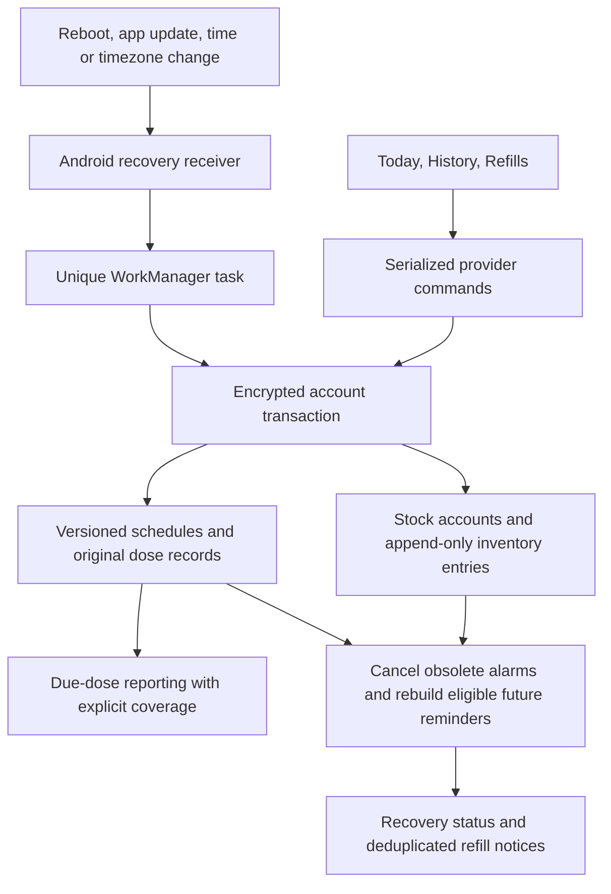

# Recovery, history, and refills system design

Scope: MED-020, MED-022, MED-023, and MED-024. Android first; local encrypted,
account-scoped data. No cloud synchronization or prescription interpretation.

## Reminder recovery

Replace cached boot restoration with a receiver that queues the existing Dart
WorkManager callback on boot, package replacement, time/timezone changes, and
exact-alarm permission grants. A unique task coalesces repeated events. The worker
reads the authoritative active account under the store lock, cancels stale OS
alarms, and builds only eligible future alerts. No historical events are written.
Normal periodic work, app startup/resume, and manual retry use the same path.

Foreground context captures wall time, Android monotonic uptime/boot count,
timezone, and recovery generation. A clock discontinuity or new recovery
generation forces native replacement even when notification payloads match.
Background recovery always forces replacement. Locked/unavailable storage retries
without inventing a key, account, stock, or dose confirmation.

Schedules stay anchored to their existing IANA timezone. A dismissible travel
notice explains device versus plan time and asks the user to verify timing with
their clinician. Acknowledgement is account-local; no clinical interval conversion
is performed. Equivalent timezone aliases/offsets do not create a travel warning.

Delivery cannot occur while a device is off. Force-stop blocks background
execution until reopen. Credential-protected storage can block recovery until
first unlock. Revoked notification/exact-alarm access is surfaced accurately;
reopen or permission grant rebuilds eligible reminders without a past-alert burst.
The OS and database do not support a shared atomic alarm transaction.

## History and recording completeness

Use the existing version-aware occurrence projection, including archived plans
and original action snapshots. Default period: seven device-local calendar days;
custom ranges: at most 366 days. Filter by medicine and Taken/Skipped/Unconfirmed.
Daily progress is recording completeness, not evidence of clinical adherence.

The denominator includes due scheduled occurrences in the selected period,
excluding paused intervals, future doses, and canceled unconfirmed occurrences.
Each new medicine records when app tracking started. Reconstructed unconfirmed
doses before that instant (or legacy plans with unknown coverage) are shown as
coverage gaps and excluded from the denominator. Explicitly recorded doses can
still be included before coverage started. Changes and archive keep old details;
corrections append events and recompute summaries. No auto-labeling as missed.

## Stock ledger

Quantities use integers at four decimal places, avoiding floating-point drift.
An active stock account has a stable ID, medicine ID, unit, threshold, revision,
and low-stock episode counter. Entries append initial stock, replenishments,
physical-count adjustments, consumption, and reversals. Balance is the signed
sum. Initial stock is a present-day baseline, not retroactive consumption.

Taken creates one consumption entry for the original dose amount; Undo reverses
only a matching outstanding consumption. Skip, snooze, and unconfirmed never
consume stock. Existing command/event idempotency prevents double decrements.
Negative balances remain visible as Needs correction; they are never clamped.
Tracked unit changes are blocked; stop tracking before starting a new unit/account.
Historical stock accounts and ledger entries remain available after stopping.

Refill adds stock. Reconcile stock sets a counted balance through a delta entry,
without touching dose history; a stale counted balance is rejected. Repeated
submissions use a stable request ID. Threshold changes are revision-checked.
Unknown, paused, low, negative, and archived states are distinct in the UI.
Supply dates are estimates using the current fixed schedule over 90 days; paused,
unknown, or incompatible-unit plans do not receive invented estimates.

Each low-stock episode receives at most one normal refill notice. Replenishment
or recovery above threshold resets the episode. Notification text remains private.
The alerted episode is committed during serialized reconciliation after native
delivery succeeds. A process death between delivery and commit can cause a retry;
stable native IDs and only-alert-once reduce duplicates, but exactly-once delivery
across OS/database failure is not promised. Permission denial does not mark sent.

## Data evolution and UI

Payload version 3 reads versions 1 and 2 without replacing the encryption key or
SQLite schema. Add stock accounts/entries and recovery metadata; old accounts
start with unknown stock. All copy transforms retain the added collections.
Explicit deletion removes a medicine's plan/history/inventory; archive preserves it.

Visual thesis: calm teal utility screens with clear typography and plain rows.
Content plan: History shows period, recording summary, daily progress, then doses;
Refills shows stock state, estimate, then stock/refill/correction controls and ledger.
Interaction thesis: standard page/sheet transitions, disclosure menus, and subtle
progress changes; filters wrap on narrow screens and respect enlarged text.

## Review and tests

Review transaction boundaries, event idempotency, old-schema migration, native
worker registration, no-past-alert behavior, inventory reversals/units/negative
stock, reporting coverage, privacy, and account switching. Add domain, provider,
notification adapter, and widget regressions, then native Android checks for
real encrypted reopen, worker recovery, timezone/reboot/update events, stock,
and alarm cancellation. Document emulator versus physical-device evidence and
iOS limitations separately. Do not close board issues without independent review.

## Platform references

- [Android broadcast exceptions](https://developer.android.com/develop/background-work/background-tasks/broadcasts/broadcast-exceptions) permits time/timezone broadcasts for alarm recovery.
- [Android WorkManager](https://developer.android.com/reference/androidx/work/WorkManager) provides persistent queued work; native alarms remain the delivery mechanism.
- [Workmanager package](https://pub.dev/packages/workmanager) documents the Dart dispatcher and task registration. The native bridge uses the public worker/constants of resolved `workmanager_android` 0.10.9; keep its integration checks when upgrading the lockfile.
